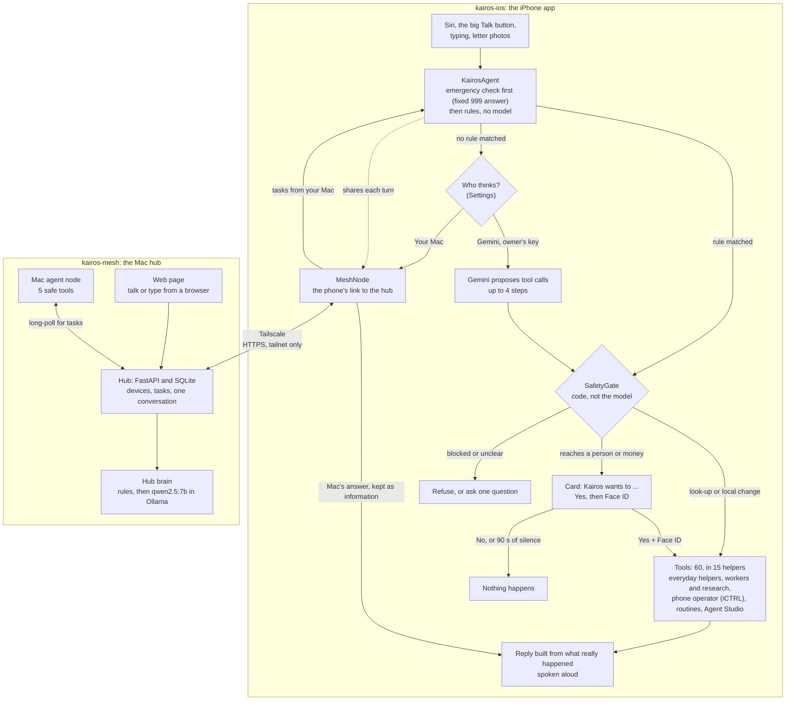

# Kairos

Kairos is a voice assistant for people who aren't confident with phones: older people, Telugu and Hindi speakers,
people new to a country, and people with low literacy or poor eyesight. You tap one big button on your iPhone (or ask
Siri) and say what you need: set an alarm, explain a letter, check a message for a scam, or ask your Mac, which shares
the same conversation through a small hub on your own private network. Code, not the model, decides what is allowed:
anything that touches money waits for your Yes and Face ID, and so does anything that reaches a person, unless you have
used Face ID to let Kairos act in that app for a while.

**Status (1 Nov 2026):** the iPhone app began at OxHack 2026 (24–25 Oct, theme TIME) and has been developed since. The
Mac hub, which joins the iPhone and the Mac into one Kairos, was added on 30–31 Oct. Tested on a real iPhone 12 Pro Max
and a MacBook Pro, mostly in English and mostly as dry runs. Each feature below says how far it has got.
**Status words:** *run on device* = seen working on the real iPhone or Mac · *built* = code exists and is wired in,
not yet run end to end · *compiled only* = written in the week to 1 Nov 2026, builds, not yet run · *planned* = only in plans.

## What's in this repo

| Folder | What it is | Language | Start here |
| --- | --- | --- | --- |
| `kairos-ios/` | The iPhone app: the big Talk button, the on-phone agent, its 60 tools and the SafetyGate. Also the self-test, the Gemini smoke test and our iCTRL patch. The Xcode project is still called "Tempo" | Swift, SwiftUI (XcodeGen) | [kairos-ios/README.md](kairos-ios/README.md) |
| `kairos-mesh/` | The Mac hub: joins your devices over Tailscale, keeps one shared conversation and task board, and runs the Mac's own agent with an open model in Ollama | Python (FastAPI, SQLite) | [kairos-mesh/README.md](kairos-mesh/README.md) |
| `docs/` | How the whole system fits together, how we test it, and what comes next | Markdown, Mermaid | [docs/ARCHITECTURE.md](docs/ARCHITECTURE.md) |
| *(not here)* `tempo-hub` | The older Mac hub from OxHack, a team build. It is not in this repo. Only the app's legacy screens (off by default) talk to it, and the Gemini smoke test can read its key file | Python | — |

## How it works



On the iPhone, almost every way in ends in one function, `KairosAgent.handle` (the Siri routine shortcut enters at
`KairosAgent.runToolStep`, which uses the same SafetyGate). Code runs first: an emergency gets fixed advice to ring
999, and rules answer what they can without any model. Only then does the chosen brain help: Gemini proposes calls to
the phone's own tools, or, with **Your Mac** chosen, the Mac's open model answers in text; every proposed call passes
the SafetyGate, and the spoken reply is built from what the tools really did. The Mac hub links your devices over
Tailscale and keeps one conversation and one task board, so each device can ask the other, and the device that holds
the data does the work under its own checks. Seven diagrams with code paths are in
[docs/ARCHITECTURE.md](docs/ARCHITECTURE.md); older design notes from 30–31 Oct (eight diagrams) are in
[kairos-mesh/docs/architecture/](kairos-mesh/docs/architecture/README.md).

## What it can do

| Feature | Example | Status |
| --- | --- | --- |
| Talk, type or ask Siri | "Hey Siri, ask Kairos", then, when Siri asks what you'd like, "What's on tomorrow?" | Built |
| Emergency answer | "Ring an ambulance, he isn't waking up" gets "Please ring 999 yourself now …" before any model runs | Run on device |
| Alarms, timers, reminders, calendar | "Wake me at half past six every weekday", "What's on tomorrow?" | Calendar read run on device; setting things built |
| Calls and messages (you tap Call or Send) | "Ring my daughter", "Text my son I'll be late" | Contact lookup run on device; calls and messages built |
| Letter reader | Photo of a council letter, explained in plain words in your language (23 listed) | Built |
| Scam Shield (offline rules) | "The bank wants me to move my savings to a safe account" | Scam check run on device; ringing 159 built |
| Money help (Kairos never pays) | "What do I do if I've been scammed?"; a payment check that hands you a bank-app checklist | Money questions run on device; payment check built |
| Everyday helpers | Weather, battery, time and world clock, torch, directions, settings help, your own Shortcuts | Weather, battery and time run on device; the rest built |
| Memory | "Remember that my GP surgery opens at 8", "What did we talk about yesterday?" | Run on device |
| Worker agents | "Create an agent to find the paper *Attention Is All You Need* and tell me the results" | Status and results run on device; workers built |
| Research team | "Research hearing aids under £500" gives a cited report | Built |
| Phone operator | "Open WhatsApp and read me the latest message" | Built; on the phone it connected to iCTRL and navigated, but no app read has succeeded yet |
| Photos | "Take a photo and put it on my Instagram story" | Built; share steps not yet checked on a phone |
| Routines | "Make a routine for my mornings: weather and today's plans", then "do my morning" | Listing run on device; replay built |
| Agent Studio | 12 ready-made helpers (Medicine Buddy, Scam Guardian, Letter Helper …) plus your own | Listing run on device |
| Owner permissions | "Let Kairos post to Instagram without asking me today" | Built |
| Joining a device to the hub | A single-use 6-digit code from `kairos-mesh/scripts/kairos pair` or **Add a device**, or its QR code scanned with the iPhone's Camera | Code run on device; QR built |
| Your Mac asks this iPhone | On the Mac: "What's on my iPhone calendar tomorrow?" (0.4 s over Tailscale, 31 Oct) | Run on device |
| This iPhone asks your Mac | "What's my Mac's battery at?" | Run on device in the 31 Oct self-test; from the Talk button not yet tried |
| The Mac's own tools | Battery and disk, find files, list a folder, read a file (never secrets), open an app | Run on device |
| Kairos in a browser | The hub's web page: talk or type, and see the conversation, your devices and the task board | Run on device |
| Your Mac as the brain | Settings › Who thinks for Kairos › Your Mac (no API key) | Built; never run in the self-test |
| Follow-ups and new routing | "Ring her then", "FaceTime my grandson", "send the photo from my gallery" | Compiled only |
| WhatsApp's new design | Reading chats with WhatsApp's new search bar | Compiled only (86/86 checks on captured screens, not yet re-run on the phone) |
| Present mode | Tap the title 5 times to show the Present Kairos button, then tap it (or say "Hey Siri, present Kairos"): Kairos presents itself | Built |

## Safety by design

- **Code decides, not the model.** The model only proposes tool calls. The SafetyGate
  (`kairos-ios/TempoApp/Agents/Core/SafetyGate.swift`) and source rules in `KairosAgent` check every one before it runs.
- **Yes, then Face ID.** Calls, messages, ringing 159, running your Shortcuts, granting a permission and preparing a
  payment always show a "Kairos wants to:" card, then Face ID or the passcode. No answer in 90 s means No. (On a phone
  with no passcode, the Yes tap is the only check. The Face ID step has been seen only in the Simulator so far.)
- **Kairos never pays, and it calls or sends only for you.** For calls and messages it opens the Call or Send screen
  and you tap. The phone operator taps buttons such as Send, Post or Call inside another app itself, but only after
  your Yes and Face ID, or for your own request in an app you have allowed with Face ID for a while (never banks or
  payments). This is built, not yet run on the phone. A prepared payment comes back with `paid: false` and a
  checklist for your bank's app.
- **Banks and passwords are locked.** The phone operator won't open or read banking and payment apps, and never types
  a PIN, password or code. No owner permission can unlock banks, payments, passwords or phone security.
- **Text from letters, web pages and messages is data, never instructions.** A number, link or email that appears only
  in such text is refused wherever it would be dialled or opened (built; this veto hasn't fired in a test yet). Text
  from Shortcuts and answers from your Mac are treated the same way.
- **999 before any model.** Emergencies get fixed advice to ring 999 (112 outside the UK) with no tool and no model.
  Kairos never rings the emergency services itself.
- **From another device, more needs your OK.** A task from your Mac that reaches a person, works another app, reads
  the screen, or changes your memory, routines or helpers always shows the card and needs Face ID on the phone
  (`remoteAlwaysConfirm`). Alarms, reminders, calendar entries and saved photos asked from the Mac are made without a
  card, and so, for now, are deleting a helper and telling a helper a fact.
- **The hub stays on your own devices' network.** Started with `kairos up`, it listens only on `127.0.0.1`, and
  `tailscale serve` shares it with your own devices over HTTPS. Requests through Tailscale Funnel (the public
  internet) get 403. Other devices join only with a single-use 6-digit code, and 20 wrong codes in 10 minutes pause
  joining. The Mac's tools refuse secrets such as a `.env` file and hand back file text as information. (Built and
  covered by the hub's tests; the Tailscale setup has run on the real Mac.)
- **Honest replies.** When Gemini is the brain, a reply may not claim an action no tool did, or quote a number no tool
  returned. Answers from your Mac are spoken as information and are not checked this way yet.
- **Dry runs for testing.** The self-test runs the rules, the model and the gate, but never a real action.

## Tools and technology

**In the iPhone app.** Paths that start with `Agents/`, and bare `.swift` file names, are in `kairos-ios/TempoApp/`.

| Tool | What for | Where |
| --- | --- | --- |
| Swift, SwiftUI, XcodeGen | The whole app | `kairos-ios/TempoApp/`, `kairos-ios/project.yml` |
| Google Gemini API (`gemini-3.5-flash-lite`; falls back to `gemini-2.5-flash`, then `gemini-3.5-flash`) | Picking tools when rules don't match, reading letters, the phone operator's planner, workers | `Agents/Core/ModelProvider.swift` |
| Gemini Google Search grounding (`gemini-2.5-flash` by default) | Research team and worker web search, with cited sources | `Agents/Research/GroundedSearch.swift` |
| App Intents | Siri phrases, Shortcuts actions, Back Tap | `TempoApp.swift`, `Agents/Siri/`, `Agents/Routines/RoutineIntents.swift` |
| Speech, AVFoundation, NaturalLanguage | Speech to text (on the phone where the language allows), spoken replies | `Agents/UI/AgentVoice.swift` |
| EventKit, AlarmKit (iOS 26) | Calendar, reminders, alarms that ring on silent | `Agents/Specialists/PlannerAgent.swift` |
| Contacts | Finding people by name or relation | `Agents/Specialists/PeopleDirectory.swift` |
| LocalAuthentication, Keychain | Face ID or passcode after Yes; keys and tokens | `Agents/Core/SafetyGate.swift` (OwnerCheck), `KeyStore.swift` |
| iCTRL (OpenMinis, Apache-2.0) | Tapping and reading other apps; runs on the phone at `127.0.0.1:8200` | `Agents/Hands/ICTRLHands.swift`; our patch in `kairos-ios/Tools/iCTRL/` |
| CryptoKit | iCTRL pairing (X25519) and sealed messages (HMAC-SHA256) | `Agents/Hands/ICTRLEnvelope.swift` |
| BackgroundTasks | Keeping a phone-operator run alive while another app is in front | `Agents/Operator/PhoneOperatorAgent.swift` |
| URLSession, PDFKit, XMLParser | Workers reading web pages, PDFs and arXiv | `Agents/Workers/WebReader.swift` |
| Open-Meteo, arXiv API, DuckDuckGo HTML | Weather, papers and fallback search, all without keys | `Agents/Specialists/HelpersAgent.swift`, `Agents/Workers/WebReader.swift` |
| Photos, ImageIO, UIKit camera | Saving photos to share; shrinking letter photos before sending | `Agents/Media/PhotoAgent.swift`, `Agents/UI/AgentCamera.swift`, `Agents/Specialists/LetterAgent.swift` |
| UserNotifications, WebKit | "Agent finished" and "report ready" notices; Google's search chip on reports | `Agents/Workers/WorkerRun.swift`, `Agents/Research/ResearchAgent.swift`, `Agents/ResearchUI/ReportsView.swift` |
| The Mac hub over Tailscale | One conversation, the Mac as brain, tasks in both directions | `Agents/Mesh/MeshNode.swift`, `Agents/Mesh/DevicesAgent.swift` |
| ElevenLabs Swift SDK 3.4.0, LiveKit 2.18.0 | The old voice call, off by default | `TempoSession.swift` |
| `xcrun devicectl`, Python, `swiftc` | Self-test runner; Gemini smoke test using the app's own Swift | `kairos-ios/Tools/SelfTest/`, `kairos-ios/Tools/GeminiSmoke/` |

**In the Mac hub.**

| Tool | What for | Where |
| --- | --- | --- |
| Python 3.12, FastAPI, Uvicorn | The hub's API on `127.0.0.1:8778` | `kairos-mesh/mesh/app.py` |
| SQLite | Devices, pairing, tasks, the shared conversation and a hash-chained log | `kairos-mesh/mesh/store.py` |
| Ollama with `qwen2.5:7b` (no API key) | The hub's brain, and the Mac node's tool use | `kairos-mesh/mesh/brain.py`, `kairos-mesh/node/mac_node.py` |
| Tailscale (`serve`, MagicDNS, HTTPS) | A private network, so the iPhone reaches the Mac from any Wi-Fi | `kairos-mesh/mesh/tailnet.py`, `kairos-mesh/mesh/ctl.py` |
| httpx, segno | Calls to the model; QR codes for pairing | `kairos-mesh/mesh/brain.py`, `kairos-mesh/mesh/app.py` |
| macOS `pmset`, `mdfind`, `textutil`, `open` | The Mac's safe tools: battery, finding files, reading documents, opening apps | `kairos-mesh/node/mac_tools.py` |
| Web Speech API | Talking to Kairos from a browser | `kairos-mesh/web/index.html` |
| pytest | The hub's tests, with a fake model and fake Tailscale | `kairos-mesh/tests/` |

Planned (none of this is built yet):

| Tool | Planned for |
| --- | --- |
| An OpenAI-compatible provider (Ollama on the Mac) | The Mac's open model calling the phone's own tools |
| llama.cpp and GGUF (a small `kairos-router`) | Common requests routed on the phone, offline |
| Apple Vision OCR | Reading letters on the phone instead of with Gemini |
| WhisperKit, sherpa-onnx, IndicConformer; our own Piper voices | Open speech in and out in Telugu and Hindi |
| SearXNG | Keyless web search |
| Secure Enclave keys, HPKE, UCAN-style grants | Device keys, Face ID-signed approvals, end-to-end encryption |
| APNs push, Live Activities | Taking tasks from the Mac while Kairos is closed |
| WatchConnectivity, Meta Wearables Device Access Toolkit | Apple Watch and Meta glasses |
| Message Filter and Call Directory extensions, Open Banking | Scam Shield at the OS level; regulated payments |

## Testing

- An on-phone **self-test** sends 165 everyday requests through the real agent and the real Gemini model on the real
  iPhone, as a dry run. On 31 Oct it routed **116 of 165**, then **152 of 165** after one round of fixes to the app
  *and* the tests (6 cases rewritten, 5 failures traced to the test harness). That is routing accuracy, not task success.
- In 30 "live" cases, read-only tools really run (17 in today's code: calendar, weather, contacts …). Three of these
  cases expect a tool that isn't one of them, and 2 live reads failed in the best run. No action was ever carried out.
- In the 31 Oct runs, the self-test reached the Mac twice from the phone (the battery, and a file search).
- Testing caught real problems. In run 1 the model offered "112 or 102" for an emergency (102 is an Indian number)
  instead of 999. Now code answers first, with 999, before any model runs.
- On the Mac, **GeminiSmoke** compiles the app's own Swift and makes 5 real Gemini calls (built; no saved output).
- The Mac hub has 61 pytest tests with a fake model and fake Tailscale.
- Not tested yet: a Face ID approval on the real phone, the letter-number veto, a WhatsApp read on the phone, the Talk
  button asking the Mac, the Mac as the brain, this week's compiled-only changes, and Telugu or Hindi beyond 2
  code-mixed cases.

Details, judging rules, how to run each check and the full results: [docs/TESTING.md](docs/TESTING.md).

## What's next

- Run the full 165 cases on today's build, then again with the Mac's open model as the brain.
- First real-phone runs of a Face ID approval, a WhatsApp read and the Talk button asking the Mac.
- Far more Telugu and Hindi cases, and open speech in and out for both languages.
- Let the Mac's open model call the phone's own tools, and train a small router so common requests work offline.
- Device keys and Face ID-signed approvals; push wake so the Mac can reach the phone while Kairos is closed.

The full plan, with why each item matters: [docs/ROADMAP.md](docs/ROADMAP.md).

## Quick start

### The iPhone app

Needs a Mac with Xcode 26 or newer, an iPhone on iOS 17 or newer (some features need iOS 26), and an Apple ID (a free
Personal Team works).

```bash
brew install xcodegen
cd kairos-ios
cp Config/Local.xcconfig.example Config/Local.xcconfig   # git-ignored; put in your team ID twice: DEVELOPMENT_TEAM,
                                                         # and DEVELOPMENT_TEAM_LOWER in lower case
xcodegen generate
open Tempo.xcodeproj                                     # choose your iPhone, press Run
```

Then, in the app, save a Gemini API key (the **gear**, then **Paste key from clipboard**), or join your Mac and let it
think. Every step, the models and the checks: [kairos-ios/README.md](kairos-ios/README.md).

### The Mac hub

Needs [Tailscale](https://tailscale.com) on the Mac and the iPhone (same account), [Ollama](https://ollama.com) and
[uv](https://docs.astral.sh/uv/).

```bash
cd kairos-mesh              # from the top of this repo
uv venv --python 3.12 .venv
uv pip install --python .venv/bin/python fastapi uvicorn httpx segno pytest
ollama pull qwen2.5:7b      # the hub's open model
scripts/kairos up           # starts the hub and the Mac's agent, and shares the hub on your tailnet
scripts/kairos pair         # a code and a QR code: scan it with the iPhone's Camera
```

Running without Tailscale, the `kairos` command, settings and how joining works:
[kairos-mesh/README.md](kairos-mesh/README.md).

## Repository layout

The iPhone app began as "Tempo" at OxHack, so the Xcode project and target are still called `Tempo`, the source
folder is `TempoApp/`, and the bundle id starts `uk.oxhack.tempo`. On the phone the app is called Kairos.

```
README.md                 this page
LICENSE                   Apache-2.0, for everything in this repo
docs/                     the whole system
  ARCHITECTURE.md         seven diagrams, with code paths
  TESTING.md              the self-test, judging rules, results, other checks
  ROADMAP.md              what comes next, and why
kairos-ios/               the iPhone app (Swift, SwiftUI)
  README.md               build, run and check it
  project.yml             XcodeGen definition; generates Tempo.xcodeproj (git-ignored)
  Config/                 Local.xcconfig.example; your own Local.xcconfig is git-ignored
  TempoApp/               the app's source: KairosAgent, the helpers, the screens
  Tools/                  GeminiSmoke, SelfTest (165 cases and the Mac runner), our iCTRL patch
kairos-mesh/              the Mac hub (Python)
  README.md               run it, the kairos command, how joining works, device runs
  pyproject.toml          the hub's Python dependencies
  mesh/                   hub API, SQLite store, brain, the kairos command, Tailscale helpers
  node/                   the Mac's own agent and its 5 safe tools
  web/                    the hub's web page
  scripts/                kairos (the command), demo_two_devices.py (an iPhone stand-in)
  tests/                  61 pytest tests
  docs/                   design, plan, architecture diagrams, tempo-hub-merge/ (for a later merge), frontend/
```

Each part keeps its own `.gitignore` (`kairos-ios/.gitignore`, `kairos-mesh/.gitignore`). The hub's database
(`kairos-mesh/data/`), its `.venv`, self-test results and `Local.xcconfig` all stay out of git.

## Privacy

Keeping your data on your own devices is our goal. Today some of it does leave the phone:

- **To Google Gemini, with your own key** (when Gemini is the brain): your words, the recent conversation, tool results,
  a short summary of the phone (such as the next 2 days of your calendar, up to 6 relevant remembered facts, recent
  actions, helper and routine names, owner permissions and worker status), photos of letters, and screen text when the
  phone operator works another app. From your contacts, the model gets names and the last 3 digits of a number, never
  the whole number or your address book. Screen text and letter photos can still contain whole numbers.
- **To your Mac, when paired:** each turn of the conversation (when a turn read a letter or the screen, Kairos's answer
  is replaced by a placeholder; follow-up questions about a letter, and answers the phone operator reads off a screen,
  are sent as said), what you ask your Mac, and the iPhone's answers to tasks your Mac sends it. The hub stores this on
  your Mac, in `kairos-mesh/data/`.
- **To Apple's speech service:** your voice, when this iPhone can't turn speech into words on the phone for your
  language.
- **To Open-Meteo, DuckDuckGo, arXiv and web sites (no key):** your home town or the place you name, for the weather,
  and the searches and pages worker agents read.
- **To ElevenLabs:** only if the old voice call is switched back on.
- **Stored on the iPhone** (parts are sent as listed above): keys and tokens (Keychain), contacts, reminders, the
  calendar, routines, helpers, memory and chat history. PINs, passwords and codes are never remembered.

## Credits

- **The OxHack 2026 team** built the first version of Kairos together. The letter reader, Scam Shield and Money helper
  are Swift ports of the team's Python from the OxHack hub (`tempo-hub`); the letter reader keeps the team's prompts as
  written, and the payment policy and payee checks are a teammate's design. Scam Shield's rules also draw on Jeevith's
  Tempo project. The "Write for me" bridge (`kairos-ios/TempoApp/Bridge/`) is teammates' code. The OxHack build
  already had the on-phone dry-run self-test (`SelfTest.swift`, 32 built-in cases, launched with `xcrun devicectl`).
- **Since OxHack**, the Mac hub (`kairos-mesh/`), one Kairos across iPhone and Mac, the 165-case self-test set with
  its Mac runner and upgrades, and the iCTRL fixes were built with AI coding agents (Claude Code), directed and
  checked by Shiva Teja. The 165 self-test cases were drafted with AI help.
- **iCTRL** is by OpenMinis (Apache-2.0) and is not included here; we only ship a patch.
- **ElevenLabs Swift SDK** and **LiveKit** are used under their own licences. Weather data is from
  [Open-Meteo](https://open-meteo.com).

## Licence

Apache License 2.0, for everything in this repo. See [LICENSE](LICENSE).
