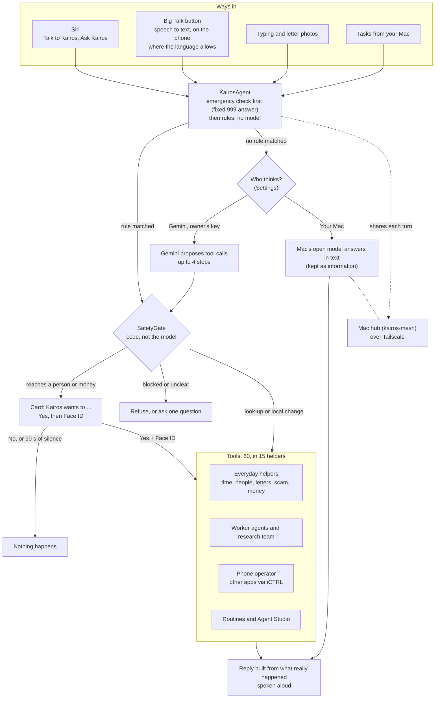

# Kairos for iPhone

Kairos is a voice assistant for people who aren't confident with phones: older people, Telugu and Hindi speakers,
people new to a country, and people with low literacy or poor eyesight. You tap one big button (or ask Siri) and say
what you need: set an alarm, explain a letter, check a message for a scam, or ask your Mac (the table below says which
of these have run on the phone). Code, not the model, decides what is allowed: anything that touches money waits for
your Yes and Face ID, and so does anything that reaches a person, unless you have used Face ID to let Kairos act in
that app for a while. So far the Face ID step has been seen only in the Simulator.

**Status:** built at OxHack 2026 (24–25 Oct, theme TIME) and developed since. Tested on a real iPhone 12 Pro Max,
mostly in English and mostly as dry runs.
**Status words:** *run on device* = seen working on the real iPhone or Mac · *built* = code exists and is wired in,
not yet run end to end · *compiled only* = written in the week to 1 Nov 2026, builds, not yet run · *planned* = only in plans.

## How it works



Almost every way in ends in one function, `KairosAgent.handle`. (The Siri routine shortcut goes straight to
`KairosAgent.runToolStep`, which uses the same SafetyGate.) Code checks run first: an emergency gets fixed advice to
ring 999, and rules answer what they can without any model. Only then does the brain help: Gemini proposes calls to
the phone's own tools, or, with **Your Mac** chosen, the Mac's open model answers in text. Every proposed call passes
the SafetyGate, and the spoken reply is built from what the tools really did. Seven diagrams with code paths are in
[docs/ARCHITECTURE.md](docs/ARCHITECTURE.md).

## What it can do

| Feature | Example | Status |
| --- | --- | --- |
| Talk, type or ask Siri | "Hey Siri, ask Kairos", then, when Siri asks what you'd like, "What's on tomorrow?" | Built |
| Emergency answer | "Ring an ambulance, he isn't waking up" gets "Please ring 999 yourself now …" before any model runs | Run on device |
| Alarms, timers, reminders, calendar | "Wake me at half past six every weekday", "What's on tomorrow?" | Calendar read run on device; setting things built |
| Calls and messages (you tap Call or Send) | "Ring my daughter", "Text my son I'll be late" | Contact lookup run on device; calls and messages built |
| Letter reader | Photo of a council letter, explained in plain words in your language (23 listed) | Built |
| Scam Shield (offline rules) | "The bank wants me to move my savings to a safe account" | Scam check run on device; ringing 159 built |
| Money help (Kairos never pays) | "What do I do if I've been scammed?"; a payment check that hands you a bank-app checklist | Money questions run on device; payment check built |
| Everyday helpers | Weather, battery, time and world clock, torch, directions, settings help, your own Shortcuts | Weather, battery and time run on device; the rest built |
| Memory | "Remember that my GP surgery opens at 8", "What did we talk about yesterday?" | Run on device |
| Worker agents | "Create an agent to find the paper *Attention Is All You Need* and tell me the results" | Status and results run on device; workers built |
| Research team | "Research hearing aids under £500" gives a cited report | Built |
| Phone operator | "Open WhatsApp and read me the latest message" | Built; on the phone it connected to iCTRL and navigated, but no app read has succeeded yet |
| Photos | "Take a photo and put it on my Instagram story" | Built; share steps not yet checked on a phone |
| Routines | "Make a routine for my mornings: weather and today's plans", then "do my morning" | Listing run on device; replay built |
| Agent Studio | 12 ready-made helpers (Medicine Buddy, Scam Guardian, Letter Helper …) plus your own | Listing run on device |
| Owner permissions | "Let Kairos post to Instagram without asking me today" | Built |
| Your Mac asks this iPhone | On the Mac: "What's on my iPhone calendar tomorrow?" (0.4 s over Tailscale, 31 Oct) | Run on device |
| This iPhone asks your Mac | "What's my Mac's battery at?" | Run on device in the 31 Oct self-test; from the Talk button not yet tried |
| Your Mac as the brain | Settings › Who thinks for Kairos › Your Mac (no API key) | Built; never run in the self-test |
| Follow-ups and new routing | "Ring her then", "FaceTime my grandson", "send the photo from my gallery" | Compiled only |
| WhatsApp's new design | Reading chats with WhatsApp's new search bar | Compiled only (86/86 checks on captured screens, not yet re-run on the phone) |
| Present mode | Tap the title 5 times to show the Present Kairos button, then tap it (or say "Hey Siri, present Kairos"): Kairos presents itself | Built |

## Safety by design

- **Code decides, not the model.** The model only proposes tool calls. The SafetyGate (`Agents/Core/SafetyGate.swift`)
  and source rules in `KairosAgent` check every one before it runs.
- **Yes, then Face ID.** Calls, messages, ringing 159, running your Shortcuts, granting a permission and preparing a
  payment always show a "Kairos wants to:" card, then Face ID or the passcode. No answer in 90 s means No. (On a phone
  with no passcode, the Yes tap is the only check. The Face ID step has been seen only in the Simulator so far.)
- **Kairos never pays, and it calls or sends only for you.** For calls and messages it opens the Call or Send screen
  and you tap. The phone operator taps buttons such as Send, Post or Call inside another app itself, but only after
  your Yes and Face ID, or for your own request in an app you have allowed with Face ID for a while (never banks or
  payments). This is built, not yet run on the phone. A prepared payment comes back with `paid: false` and a
  checklist for your bank's app.
- **Banks and passwords are locked.** The phone operator won't open or read banking and payment apps, and never types
  a PIN, password or code. No owner permission can unlock banks, payments, passwords or phone security.
- **Text from letters, web pages and messages is data, never instructions.** A number, link or email that appears only
  in such text is refused wherever it would be dialled or opened (built; this veto hasn't fired in a test yet). Text
  from Shortcuts and answers from your Mac are treated the same way.
- **999 before any model.** Emergencies get fixed advice to ring 999 (112 outside the UK) with no tool and no model.
  Kairos never rings the emergency services itself.
- **From another device, more needs your OK.** A task from your Mac that reaches a person, works another app, reads
  the screen, or changes your memory, routines or helpers always shows the card and needs Face ID on the phone
  (`remoteAlwaysConfirm`). Alarms, reminders, calendar entries and saved photos asked from the Mac are made without a
  card, and so, for now, are deleting a helper and telling a helper a fact.
- **Honest replies.** When Gemini is the brain, a reply may not claim an action no tool did, or quote a number no tool
  returned. Answers from your Mac are spoken as information and are not checked this way yet.
- **Dry runs for testing.** The self-test runs the rules, the model and the gate, but never a real action.

## Tools and technology

| Tool | What for | Where |
| --- | --- | --- |
| Swift, SwiftUI, XcodeGen | The whole app | `TempoApp/`, `project.yml` |
| Google Gemini API (`gemini-3.5-flash-lite`; falls back to `gemini-2.5-flash`, then `gemini-3.5-flash`) | Picking tools when rules don't match, reading letters, the phone operator's planner, workers | `Agents/Core/ModelProvider.swift` |
| Gemini Google Search grounding (`gemini-2.5-flash` by default) | Research team and worker web search, with cited sources | `Agents/Research/GroundedSearch.swift` |
| App Intents | Siri phrases, Shortcuts actions, Back Tap | `TempoApp.swift`, `Agents/Siri/`, `Agents/Routines/RoutineIntents.swift` |
| Speech, AVFoundation, NaturalLanguage | Speech to text (on the phone where the language allows), spoken replies | `Agents/UI/AgentVoice.swift` |
| EventKit, AlarmKit (iOS 26) | Calendar, reminders, alarms that ring on silent | `Agents/Specialists/PlannerAgent.swift` |
| Contacts | Finding people by name or relation | `Agents/Specialists/PeopleDirectory.swift` |
| LocalAuthentication, Keychain | Face ID or passcode after Yes; keys and tokens | `Agents/Core/SafetyGate.swift` (OwnerCheck), `KeyStore.swift` |
| iCTRL (OpenMinis, Apache-2.0) | Tapping and reading other apps; runs on the phone at `127.0.0.1:8200` | `Agents/Hands/ICTRLHands.swift`; our patch in `Tools/iCTRL/` |
| CryptoKit | iCTRL pairing (X25519) and sealed messages (HMAC-SHA256) | `Agents/Hands/ICTRLEnvelope.swift` |
| BackgroundTasks | Keeping a phone-operator run alive while another app is in front | `Agents/Operator/PhoneOperatorAgent.swift` |
| URLSession, PDFKit, XMLParser | Workers reading web pages, PDFs and arXiv | `Agents/Workers/WebReader.swift` |
| Open-Meteo, arXiv API, DuckDuckGo HTML | Weather, papers and fallback search, all without keys | `Agents/Specialists/HelpersAgent.swift`, `Agents/Workers/WebReader.swift` |
| Photos, ImageIO, UIKit camera | Saving photos to share; shrinking letter photos before sending | `Agents/Media/PhotoAgent.swift`, `Agents/UI/AgentCamera.swift`, `Agents/Specialists/LetterAgent.swift` |
| UserNotifications, WebKit | "Agent finished" and "report ready" notices; Google's search chip on reports | `Agents/Workers/WorkerRun.swift`, `Agents/Research/ResearchAgent.swift`, `Agents/ResearchUI/ReportsView.swift` |
| The kairos-mesh hub (a separate repo) over Tailscale | One conversation, the Mac as brain, tasks in both directions | `Agents/Mesh/MeshNode.swift`, `Agents/Mesh/DevicesAgent.swift` |
| ElevenLabs Swift SDK 3.4.0, LiveKit 2.18.0 | The old voice call, off by default | `TempoSession.swift` |
| `xcrun devicectl`, Python, `swiftc` | Self-test runner; Gemini smoke test using the app's own Swift | `Tools/SelfTest/`, `Tools/GeminiSmoke/` |

Planned (none of this is built yet):

| Tool | Planned for |
| --- | --- |
| An OpenAI-compatible provider (Ollama on the Mac) | The Mac's open model calling the phone's own tools |
| llama.cpp and GGUF (a small `kairos-router`) | Common requests routed on the phone, offline |
| Apple Vision OCR | Reading letters on the phone instead of with Gemini |
| WhisperKit, sherpa-onnx, IndicConformer; our own Piper voices | Open speech in and out in Telugu and Hindi |
| SearXNG | Keyless web search |
| Secure Enclave keys, HPKE, UCAN-style grants | Device keys, Face ID-signed approvals, end-to-end encryption |
| APNs push, Live Activities | Taking tasks from the Mac while Kairos is closed |
| WatchConnectivity, Meta Wearables Device Access Toolkit | Apple Watch and Meta glasses |
| Message Filter and Call Directory extensions, Open Banking | Scam Shield at the OS level; regulated payments |

## Testing

- An on-phone **self-test** sends 165 everyday requests through the real agent and the real Gemini model on the real
  iPhone, as a dry run. On 31 Oct it routed **116 of 165**, then **152 of 165** after one round of fixes to the app
  *and* the tests (6 cases rewritten, 5 failures traced to the test harness). That is routing accuracy, not task success.
- In 30 "live" cases, read-only tools really run (17 in today's code: calendar, weather, contacts …). Three of these
  cases expect a tool that isn't one of them, and 2 live reads failed in the best run. No action was ever carried out.
- The kairos-mesh hub has 61 pytest tests with a fake model and fake Tailscale.
- Not tested yet: a Face ID approval on the real phone, the letter-number veto, a WhatsApp read on the phone, the Mac as
  the brain, this week's compiled-only changes, and Telugu or Hindi beyond 2 code-mixed cases.

Details, judging rules and the full results: [docs/TESTING.md](docs/TESTING.md).

## What's next

- Run the full 165 cases on today's build, then again with the Mac's open model as the brain.
- First real-phone runs of a Face ID approval, a WhatsApp read and the Talk button asking the Mac.
- Far more Telugu and Hindi cases, and open speech in and out for both languages.
- Let the Mac's open model call the phone's own tools, and train a small router so common requests work offline.
- Device keys and Face ID-signed approvals; push wake so the Mac can reach the phone while Kairos is closed.

The full plan, with why each item matters: [docs/ROADMAP.md](docs/ROADMAP.md).

## Build and run

Needs a Mac with Xcode 26 or newer, an iPhone on iOS 17 or newer (some features need iOS 26), and an Apple ID
(a free Personal Team works; apps then expire after 7 days).

```bash
brew install xcodegen
cp Config/Local.xcconfig.example Config/Local.xcconfig   # git-ignored; put in your team ID twice: DEVELOPMENT_TEAM,
                                                         # and DEVELOPMENT_TEAM_LOWER in lower case
xcodegen generate
open Tempo.xcodeproj                                     # choose your iPhone, press Run
```

Then, on the iPhone:

1. Open Kairos and tap **More: type, photos, helpers**. Allow Reminders, Calendar, Alarms and Contacts.
2. Get a Gemini API key at [aistudio.google.com/apikey](https://aistudio.google.com/apikey). Copy it on the phone,
   tap the **gear**, then **Paste key from clipboard**. The key is kept only in the iPhone's Keychain.
3. Try "Set a timer for 2 minutes", "What's on tomorrow?", or "Create an agent to find out what's new in iOS 27".

**Models.** Kairos thinks with `gemini-3.5-flash-lite` and falls back to `gemini-2.5-flash`, then `gemini-3.5-flash`.
Settings also offers `gemini-3.8-flash` ("Careful") and `gemini-2.5-flash` ("Older model"), or a model name of your
own. Web search uses `gemini-2.5-flash`, because on 25 Oct the 3.5 models answered every grounded search with a
rate-limit error on a free key; change it with the `kairos.agents.searchModel` setting. A second "backup" key from
another Google project raises the per-minute allowance. Kairos keeps itself under the free tier on its own
(14 requests a minute for lite models, 9 for others), and your own requests always go before background work.

**Optional: one Kairos across your iPhone and Mac.** This needs the kairos-mesh hub (a separate repo, not public yet)
on your Mac, set up as its README says (a Python 3.12 `.venv`).
- **Join:** install Tailscale on both with the same account. In the kairos-mesh repo run `scripts/kairos up`, then
  `scripts/kairos pair` (or **Add a device** on the Mac's page), and scan the QR code with the iPhone's Camera.
  Kairos asks, then Face ID, and joins only if the Mac was really reached through Tailscale. (This QR route is built
  but not yet tried on a real phone. Pairing with a code has been.)
- **Who thinks:** rules on the phone first. What they don't know goes to your chosen brain (Settings › Who thinks for
  Kairos): **Your Mac** (the hub's open model, no API key; the default when no Gemini key is saved) or **Gemini**.
  Reading letters needs Gemini, because the Mac's model can't read photos yet.
- **One conversation:** what you say here is added to the hub's conversation, so the Mac knows it.
- **Your Mac can ask this iPhone** while Kairos is open. The task runs through `KairosAgent` here. With Gemini as the
  brain it is handled like something you typed. With Your Mac as the brain, only requests the phone's rules understand
  work ("what's on my calendar tomorrow"). Anything that reaches a person or works another app always shows the card
  and needs Face ID here.
- **The line under the title** says where your Mac is in plain words (connected, Tailscale off, Mac asleep, Kairos not
  running on the Mac). Tap it to try again.

**Optional: the phone operator** needs the iCTRL runner on the phone (Developer Mode and UI Automation on, started from
the Mac with Xcode). iOS stops the runner whenever the phone locks, so keep Auto-Lock off while you use it. Apply our
crash fixes from [Tools/iCTRL](Tools/iCTRL/README.md) before building it (they compile but haven't run on the phone yet).

**Legacy OxHack screens.** The old ElevenLabs Talk call, the Shield badge, "Write for me" and the old letter screen all
talk to the OxHack Mac hub (`tempo-hub`). They are off unless `kairos.legacy_voice` is set in UserDefaults.

## Checking it works

```bash
# 5 real Gemini calls using the app's own Swift (tool call, tool result, JSON, photo, grounded search).
# Reads GEMINI_API_KEY= from ../tempo-hub/agents/.env, a folder beside this repo (create it if you don't have the
# OxHack hub). Prints only the key's last 3 characters.
Tools/GeminiSmoke/run.sh

# Which models can use Google Search on your key, and why not.
python3 -I Tools/GeminiSmoke/search_check.py

# The on-phone self-test, driven from the Mac (phone unlocked and connected).
# Set KAIROS_DEVICE and KAIROS_BUNDLE to your iPhone's id and your app's bundle id.
python3 -I Tools/SelfTest/run_selftest.py Tools/SelfTest/cases.json --out Tools/SelfTest/results
python3 -I Tools/SelfTest/run_selftest.py Tools/SelfTest/smoke.json --out Tools/SelfTest/results   # 4-case quick check
```

You can also start the self-test on the phone: **More › Developer › Run self-test (dry run)** (32 built-in cases), or
launch the app with `-KairosSelfTest`. Results are git-ignored, because they hold real names and memories from the phone.

## Project layout

```
TempoApp/                   the app (SwiftUI)
  TempoApp.swift            entry point, Siri phrases, kairos:// links
  ContentView.swift         the main screen: one big Talk button
  KeyStore.swift            Keychain helper
  TempoSession.swift        old ElevenLabs call (legacy flag only)
  LetterReader.swift,
  ShieldView.swift          old OxHack screens that talk to tempo-hub (legacy flag only)
  Agents/
    AgentAppHooks.swift     wires the agents into the app
    Core                    KairosAgent, SafetyGate, AgentDirectory, tool contract, Gemini client, rate limiter
    Context                 what the model knows about the phone
    Specialists             time, people, letter reader, scam shield, money, everyday helpers
    Memory, MemoryUI        remembered facts and chat history
    Mesh                    link to the kairos-mesh hub, "ask my Mac"
    Workers, WorkersUI      worker agents and the Agents board
    Research, ResearchUI    research team and Reports
    Operator                phone operator: planner, screen digest, app skills
    Hands                   iCTRL client: pairing and sealed messages
    Hooks                   shared runner and the PhoneHands protocol
    Routines                saved routines, Siri and Shortcuts entities
    Studio, StudioUI        Agent Studio
    Trust                   owner permissions
    Media                   take a photo and share it
    Siri                    App Intents (Ask Kairos, Tell Kairos, …)
    SelfTest                on-phone dry-run self-test
    Showcase, ShowcaseUI    Present mode
    UI                      voice, settings, the More screen, approval card, camera
  Bridge/                   "Write for me" message drafting (OxHack team code, legacy flag only)
Tools/
  GeminiSmoke/              real Gemini calls with the app's own Swift; search check
  SelfTest/                 165 cases, 4-case smoke set, Mac runner (results/ is git-ignored)
  iCTRL/                    our crash-fix patch for iCTRL
docs/                       architecture, testing, roadmap
Config/                     Local.xcconfig.example
project.yml                 XcodeGen project definition
```

## Privacy

Keeping your data on your own devices is our goal. Today some of it does leave the phone:

- **To Google Gemini, with your own key** (when Gemini is the brain): your words, the recent conversation, tool results,
  a short summary of the phone (the next 2 days of your calendar and up to 6 relevant remembered facts), photos of
  letters, and screen text when the phone operator works another app. From your contacts, the model gets names and the
  last 3 digits of a number, never the whole number or your address book. Screen text and letter photos can still
  contain whole numbers.
- **To your Mac, when paired:** each turn of the conversation (letter and screen answers are replaced by a placeholder),
  what you ask your Mac, and the iPhone's answers to tasks your Mac sends it. The hub stores this on your Mac.
- **To Apple's speech service:** your voice, when this iPhone can't turn speech into words on the phone for your
  language.
- **To Open-Meteo, DuckDuckGo, arXiv and web sites (no key):** your home town or the place you name, for the weather,
  and the searches and pages worker agents read.
- **To ElevenLabs:** only if the old voice call is switched back on.
- **Stored on the iPhone** (parts are sent as listed above): keys and tokens (Keychain), contacts, reminders, the
  calendar, routines, helpers, memory and chat history. PINs, passwords and codes are never remembered.

## Credits

- **The OxHack 2026 team** built the first version of Kairos together. The letter reader, Scam Shield and Money helper
  are Swift ports of the team's Python from the OxHack hub (`tempo-hub`); the letter reader keeps the team's prompts as
  written, and the payment policy and payee checks are a teammate's design. Scam Shield's rules also draw on Jeevith's
  Tempo project. The "Write for me" bridge (`Bridge/`) is teammates' code.
- **Since OxHack**, one Kairos across iPhone and Mac, the self-test and the iCTRL fixes were built with AI coding
  agents (Claude Code), directed and checked by Shiva Teja. The 165 self-test cases were drafted with AI help.
- **iCTRL** is by OpenMinis (Apache-2.0) and is not included here; we only ship a patch.
- **ElevenLabs Swift SDK** and **LiveKit** are used under their own licences. Weather data is from
  [Open-Meteo](https://open-meteo.com).

## Licence

Apache License 2.0. See [LICENSE](LICENSE).
