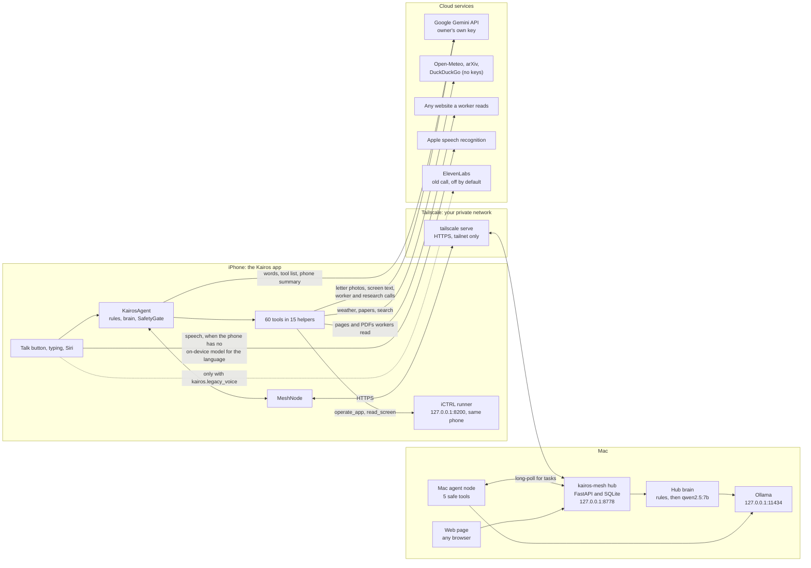
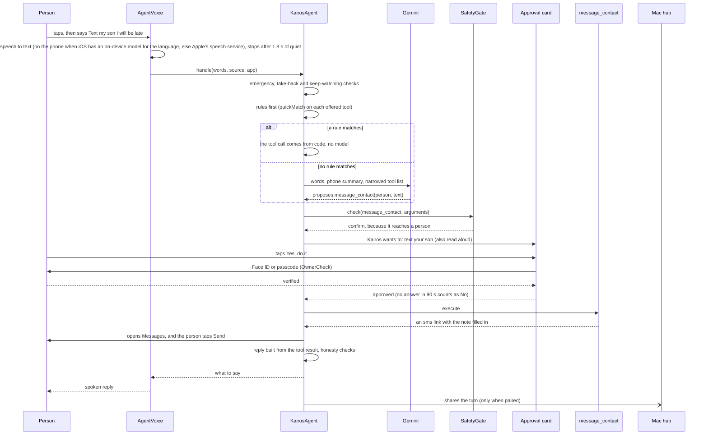
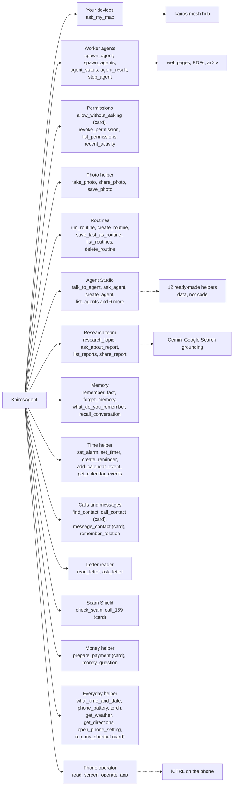
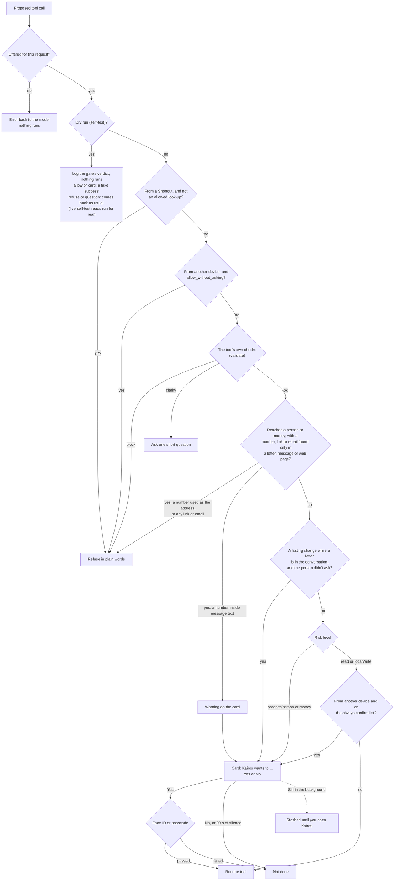
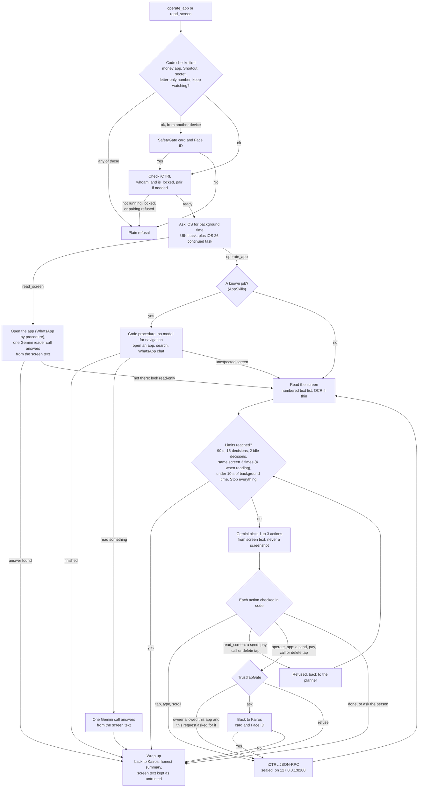
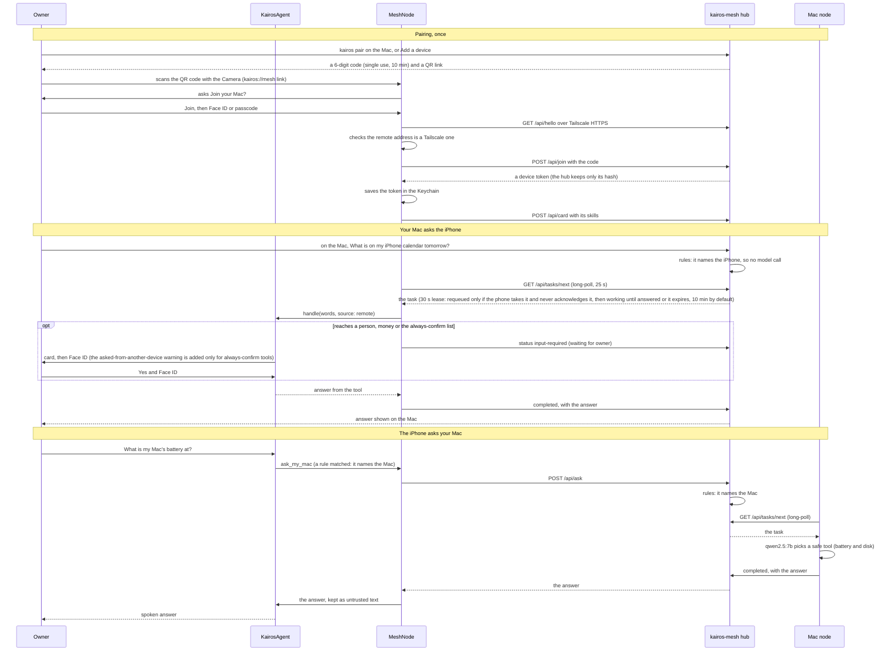
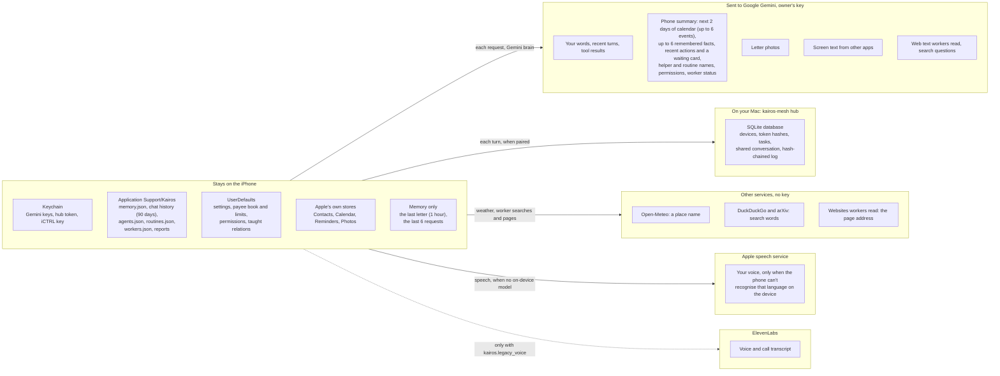

# Architecture

This page explains how Kairos is put together, the iPhone app and the Mac hub, in seven diagrams. Each one says what
it shows, how to read it, and where the code is.

Where the code is: this repo has two parts. The iPhone app is in `kairos-ios/`, and its code is in
`kairos-ios/TempoApp/` (the Xcode project still uses the OxHack name, Tempo). Paths that start with `Agents/`, and bare
file names such as `TempoApp.swift`, `TempoSession.swift`, `ContentView.swift` and `KeyStore.swift`, are under
`kairos-ios/TempoApp/`. The test tools are in `kairos-ios/Tools/`. The Mac hub is in `kairos-mesh/`, and its files are
written in full, such as `kairos-mesh/mesh/app.py`. The hub also has its own notes and eight SVG diagrams in
`kairos-mesh/docs/architecture/`.

Status words, as in the [README](../README.md): *run on device* = seen working on the real iPhone or Mac;
*built* = code exists and is wired in, not yet run end to end; *compiled only* = written in the week to 1 Nov 2026,
builds, not yet run; *planned* = only in plans.

## A few terms first

- **KairosAgent** (`kairos-ios/TempoApp/Agents/Core/KairosAgent.swift`) is the one orchestrator. Almost every request
  goes through `KairosAgent.handle(_:source:images:)`. Siri routines, Siri asking a named helper while a helper is in focus,
  and an approved Siri stash enter at `runToolStep`, `StudioHandoff` or `resumeStashed` instead. All of them use the
  same `run()` and SafetyGate.
- **Source** says where a request came from: `app` (the Talk button or typing), `siriBackground` ("Ask Kairos"),
  `automation` (a Shortcut's "Tell Kairos"), or `remote` (a task from your Mac). A fifth value, `siriForeground`,
  exists but nothing passes it today.
- **Tools.** There are 60, spread across 15 specialist agents listed in `Agents/Core/AgentDirectory.swift`. Each tool
  follows the `KairosTool` contract in `Agents/Core/AgentKit.swift`: a name, a JSON schema, a risk level, an optional
  rules-first `quickMatch`, code checks in `validate`, the card text in `describe`, and `execute`.
- **Risk levels:** `read` (35 tools) < `localWrite` (19) < `reachesPerson` (5) < `money` (1). The SafetyGate uses
  them to decide whether a card and Face ID are needed.
- **Untrusted text.** Text from letters, web pages, pasted messages, Shortcuts and the Mac's answers goes into
  `TurnContext.documents`. It is information, never instructions. The person's own words go into `userWords`.

## 1. System overview

**What this shows:** every machine and service Kairos talks to, and how they connect.

**How to read it.** Solid arrows are used today; the dotted one is the old voice call, which is off unless a flag is
set. The iPhone does its own work: rules, tools and the SafetyGate all run on the phone. Gemini is the only cloud
language model. It is meant to be used only when the owner picks it as the brain and has saved a key: the main
request path follows this, but not every part has been audited for it yet (see diagram 7). Speech to text stays on the
phone where the language allows; otherwise Apple's speech service is used. iCTRL is a separate test runner
that lives **on the same iPhone**; the app talks to it over loopback, not over the network. Started with `kairos up`,
the Mac hub listens only on `127.0.0.1`, and `tailscale serve` shares it with your own devices over HTTPS. A request
that comes through Tailscale Funnel (the public internet) gets `403`. Without Tailscale, the hub can instead be
started with `--host 0.0.0.0` and the names it should answer to in `KAIROS_MESH_HOSTS`, and the phone then talks to it
over plain http on the Wi-Fi or a USB cable (the 31 Oct USB test used plain http). The Mac node is the Mac's own
agent: it joins the hub by itself as "this computer" (no code, sharing that identity with the Mac's browser page),
while every other device needs a 6-digit code. It answers tasks with five safe tools (battery and disk, find files,
list a folder, read a file, open an app).

Status: *run on device* in both directions. On 31 Oct the Mac asked the real iPhone 12 Pro Max over USB (0.8 s) and
over Tailscale (0.4 s), and the iPhone asked the Mac inside the on-phone self-test. The Talk button asking the Mac
hasn't been tried yet.

**Code:** `TempoApp.swift`, `ContentView.swift`, `Agents/Core/KairosAgent.swift`,
`Agents/Core/ModelProvider.swift`, `Agents/Mesh/MeshNode.swift`, `Agents/Hands/ICTRLHands.swift`,
`Agents/UI/AgentVoice.swift`, `Agents/Workers/WebReader.swift`, `TempoSession.swift`; the hub:
`kairos-mesh/mesh/app.py`, `kairos-mesh/mesh/brain.py`, `kairos-mesh/mesh/store.py`, `kairos-mesh/mesh/ctl.py`,
`kairos-mesh/node/mac_node.py`, `kairos-mesh/node/mac_tools.py`, `kairos-mesh/web/index.html`.

## 2. One request, end to end

**What this shows:** what happens between "Text my son I'll be late" and the spoken reply, including the card and
Face ID.

**How to read it.** Time runs downwards. The order inside `handleBody` is fixed: code-only checks (emergency,
"can't keep watching", "don't send that"), then rules, then a photo goes straight to `read_letter`, and only then the
model loop. The model loop runs up to 4 steps. In each step Gemini sees only the tools `ToolPicker` thinks the words
call for (plus a small core set), and every call it proposes goes back through the SafetyGate. If the brain is
**Your Mac** instead of Gemini, the phone sends the words to the hub and speaks the hub's text answer; the Mac's model
does not call the phone's tools. At the end, code checks the reply: a claim of an action no tool did, or a number no
tool returned, is replaced with an honest line. A Siri request in the background can't show a card, so the call is
stashed and Siri says "Open Kairos to check it and say yes".

Status: the request path up to the card is *run on device* (in dry runs); the card and Face ID are *built* and have
been seen only in the Simulator.

**Code:** `Agents/UI/AgentVoice.swift` (speech), `Agents/Core/KairosAgent.swift` (`handle`, `handleBody`, `run`,
`askOwner`, `claimsDone`, `numbersGrounded`), `Agents/Core/AgentKit.swift` (`ToolPicker`),
`Agents/Core/SafetyGate.swift`, `Agents/UI/AgentConfirmCard.swift`, `Agents/Specialists/PeopleAgent.swift`,
`Agents/Siri/AgentIntents.swift` (Siri's 12 s budget and the stash).

## 3. The agent map

**What this shows:** the 15 specialist agents KairosAgent can hand work to, and their tools.

**How to read it.** The agents are listed top to bottom in the order the rules try them, which matters: "on my Mac"
is matched before anything else, so the Mac wins. "(card)" marks the six tools that always need the Yes card and
Face ID. Dotted arrows show what an agent reaches outside the app. Agent Studio's 12 ready-made helpers (Medicine
Buddy, Scam Guardian, Letter Helper, Morning Briefer and others) are personas stored as data: each is a name,
instructions and a list of allowed tools. Talking to one ("focus mode") limits the offered tools to that helper's
list, plus a few core tools such as the way back to Kairos. Worker agents are created at run time; up to 3 run at once.

Some details worth knowing:

- **Workers** may finish as "done" only with evidence (a page or PDF they read, a grounded search, arXiv details or
  read-only phone data), and every number they report must appear in text they fetched.
- **The research team** plans 2 or 3 sub-questions, searches with Google Search grounding one search at a time
  (an app-wide pacer keeps to the free tier), and writes a report whose links come only from Google's grounding data.
- **Routines** replay saved steps with no model call, but every step still goes through the SafetyGate.
- **Calls and messages** hand a `tel:`, `sms:` or `wa.me` link to iOS; the person taps Call or Send.

Status: see the table in the [README](../README.md#what-it-can-do).

**Code:** `Agents/Core/AgentDirectory.swift`; the agents live under `Agents/` (`Mesh/DevicesAgent.swift`,
`Workers/`, `Trust/`, `Media/`, `Routines/`, `Studio/`, `Research/`, `Memory/`, `Operator/`, and six in
`Specialists/`: time, people, letters, Scam Shield, money and the everyday helper); ready-made helpers in
`Agents/Studio/BuiltinAgents.swift`.

## 4. The SafetyGate decision

**What this shows:** how code decides whether a proposed tool call is refused, needs a question, needs the card and
Face ID, or simply runs.

**How to read it.** Start at the top. Diamonds are checks made by code; none of them asks the model. Three things
come from the request's source: a Shortcut's text may only trigger read-only tools that don't open apps, the camera or
other helpers; "allow without asking" can only be granted on the phone itself; and from another device, 16 tools that
work other apps, read the screen or save lasting things (`remoteAlwaysConfirm`) always need the card. The
"found only in a letter" check is the injection veto. For tools that reach a person or money, it looks at every run of
6 or more digits, every link and every email in the arguments that appears in untrusted text but never in the
person's own words. Such a number used as the address (a field that would be dialled or paid to), and any such link
or email, is refused; such a number inside message text puts a warning on the card. `operate_app` and `read_screen`
run the same check in their own `validate` and always refuse. In a dry run, only the Shortcut rule and the gate are
checked (not the other-device rules), and `prepare_payment` is recorded as needing a card without running its check.
Two caveats: on a phone with no passcode, `OwnerCheck` lets the Yes tap stand alone; and the owner's "allow without
asking" permissions do not skip this gate. They apply only to the phone operator's taps (diagram 5).

Status: *built*. The gate runs on every request, and its verdicts were logged in the dry-run self-test on the phone,
but the letter-number veto hasn't fired in a test yet, and Face ID has been seen only in the Simulator.

**Code:** `Agents/Core/SafetyGate.swift` (`check`, `documentOnlyValue`, `persistent`, `OwnerCheck`),
`Agents/Core/KairosAgent.swift` (`run`, `automationDenied`, `remoteDenied`, `remoteAlwaysConfirm`, `askOwner`,
`dryRunOutcome`), `Agents/UI/AgentConfirmCard.swift`.

## 5. The phone operator and iCTRL

**What this shows:** how Kairos works another app for you, one screen at a time, and where code stops it.

**How to read it.** The loop in the middle repeats: read the screen, decide, act, read again. From another device,
both tools first need the SafetyGate's card and Face ID (`remoteAlwaysConfirm`). In `operate_app`, known jobs navigate
as fixed code with no model calls; when they read something, one Gemini call answers from the screen text.
`read_screen` opens the app (WhatsApp by procedure), then one Gemini "reader" call answers from the screen text. If
the answer isn't there, the planner looks for it read-only, and any send, pay, call or delete tap is refused and goes
back to the planner. In the planner loop, Gemini sees the screen as a short numbered list of labels (at most 60 lines)
and proposes 1 to 3 actions. Code checks every one: it never taps the microphone, voice-message or Meta AI controls,
refuses number-pad digits and bank icons, types only words that came from the request, and never types into a PIN or
password field. In `operate_app`, a tap that sends, pays, calls or deletes goes to `TrustTapGate`. That is the one
place where the owner's "allow without asking" permission counts, and only when this request asked for that action in
an app it named; banks, payments and rows that ring someone always ask. The phone talks to iCTRL over loopback with
messages sealed with a key from a one-time X25519 pairing (an HMAC-SHA256 keystream and tag, not TLS). A
screen-changing call is never re-sent after a timeout, because iCTRL may still finish it.

Status: *built*. On the real phone the operator connected to iCTRL and navigated, but no app read has succeeded yet.
*Compiled only*: WhatsApp's new-design reading (86/86 checks on captured screens, in a harness kept outside the
repo), the hand-back when iOS ends background time early, FaceTime and gallery-photo routing, and our iCTRL crash
fixes (`kairos-ios/Tools/iCTRL/`).

**Code:** `Agents/Operator/PhoneOperatorAgent.swift` (`OperatorRun`, `OperatorDriver`, `OperatorPlanner`,
`OperatorBackground`), `Agents/Operator/AppSkills.swift`, `Agents/Operator/ScreenDigest.swift`,
`Agents/Trust/TrustAgent.swift` (`TrustTapGate`), `Agents/Trust/OwnerPolicy.swift`, `Agents/Hands/ICTRLHands.swift`,
`Agents/Hands/ICTRLEnvelope.swift`, `Agents/Hooks/AgentHooks.swift` (`PhoneHands`).

## 6. The mesh: pairing, and requests in both directions

**What this shows:** how the iPhone joins your Mac's hub, how the Mac asks the iPhone, and how the iPhone asks the Mac.

**How to read it.** Time runs downwards, in three parts. A QR link never joins silently: Kairos asks "Join your Mac?"
and needs Face ID or the passcode. For a `.ts.net` hub (by link or typed in), the join is refused if the remote
address iOS reports is outside `100.64.0.0/10` and `fd7a:115c:a1e0::/48`, so a public name with the same `.ts.net`
ending can't stand in. Your Mac's hub address looks like `https://mac.tail1234.ts.net`. Two gaps: typing an address
and code in Settings › Your Mac joins without Face ID, and a plain http address on the Wi-Fi or a USB cable skips the
Tailscale check (as does a connection where iOS reports no remote address). When the Mac asks, the phone runs the task
through the same `KairosAgent` and SafetyGate as anything you typed, and `remoteAlwaysConfirm` turns any risky "allow"
into a card on the phone; the hub's task board shows "waiting for owner" meanwhile. When the phone asks, the Mac's
answer comes back as untrusted text, so a number or link in it can't later be dialled or opened as if you had said it.
The phone takes tasks only while Kairos is open (`MeshNode` starts when the app is active and stops in the
background). After each request from the app or Siri, the phone also copies the turn to the hub's shared conversation.

Status: pairing by code, the Mac asking the iPhone (calendar: 0.8 s over USB and 0.4 s over Tailscale on 31 Oct), and
the iPhone asking the Mac inside the 31 Oct self-test are *run on device*. The QR link, the pairing alert with Face ID,
the Talk button asking the Mac and a Face ID approval on a remote task have not been tried on the real phone yet (the
remote call card worked in the Simulator).

**Code:** `Agents/Mesh/MeshNode.swift` (`handle`, `pair`, `run`, `work`, `ask`, `shareTurn`),
`Agents/Mesh/DevicesAgent.swift` (`ask_my_mac`), `Agents/Core/KairosAgent.swift` (`remoteDenied`,
`remoteAlwaysConfirm`), `ContentView.swift` (the "Join your Mac?" alert and the connection line); the hub:
`kairos-mesh/mesh/app.py`, `kairos-mesh/mesh/store.py`, `kairos-mesh/mesh/brain.py`, `kairos-mesh/mesh/tailnet.py`,
`kairos-mesh/node/mac_node.py`, `kairos-mesh/node/mac_tools.py`.

## 7. Where data lives

**What this shows:** what stays on the phone, what is kept on your Mac, and what is sent to cloud services today.

**How to read it.** The left box is what stays on the phone. Arrows show what leaves it. Keeping your data on your own
devices is our goal, not today's state: with Gemini as the brain, each request sends your words and some context to
Google, and when the phone is paired, each turn is copied to the hub on your Mac. Some limits on what leaves:

- From your contacts, the model sees names, number types and the last 3 digits of a number, never the whole number.
  Screen text and letter photos can still contain whole numbers.
- Memory sends at most 6 relevant facts (700 characters) per request. PINs, passwords and codes are never remembered.
- A letter photo is shrunk to at most 1600 px and is never stored; the explanation is kept in memory for an hour.
- Turns that used `read_letter` or `read_screen` are copied to the Mac as "[answered on the iPhone]". Follow-up
  questions about a letter (`ask_letter`) and answers `operate_app` read off a screen are copied as said.
- The phone operator sends screen *text*, never screenshots, and refuses to read banking and payment apps for this
  reason.
- With **Your Mac** as the brain, the main request path doesn't call Google. Reading letters still needs Gemini, and
  we haven't yet audited every other part (such as the research team) for this setting.

**Code:** `Agents/Core/ModelProvider.swift` (`AgentSettings`, keys via `KeyStore.swift`), `Agents/UI/AgentVoice.swift`
(speech), `Agents/Context/PhoneContext.swift`, `Agents/Workers/WebReader.swift`, `Agents/Memory/MemoryStore.swift`,
`Agents/Memory/ConversationStore.swift`, `Agents/Memory/MemoryContext.swift`, `Agents/Studio/AgentSpec.swift`,
`Agents/Routines/RoutineStore.swift`, `Agents/Workers/WorkerRun.swift`, `Agents/Research/ReportStore.swift`,
`Agents/Specialists/MoneyAgent.swift`, `Agents/Trust/OwnerPolicy.swift`, `Agents/Specialists/LetterAgent.swift`,
`Agents/Mesh/MeshNode.swift` (`shareTurn`); the hub: `kairos-mesh/mesh/store.py`.
