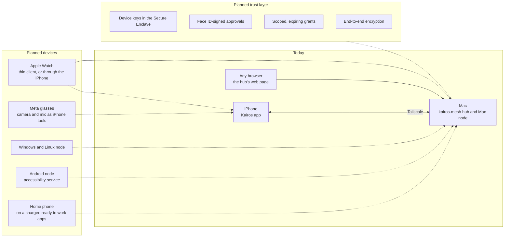

# Roadmap

What we're building next, why, and what Kairos can't do yet. Phase 1 is mostly *run on device*, and the next section
is code that is *compiled only*. From Phase 2 on, the work is **planned**: not built, apart from the pieces a section
says already exist. Status words, as in the [README](../README.md): *run on device*, *built*, *compiled only*,
*planned*. The hub's longer design notes and plan are in `kairos-mesh/docs/DESIGN.md` and `kairos-mesh/docs/PLAN.md`.

## Where we are

Kairos began at OxHack 2026 (24–25 Oct) as an iPhone app with on-phone agents. Since then it has become one assistant
across an iPhone and a Mac: on 31 Oct the Mac asked the real iPhone's agent about its calendar and got the answer in
0.4 s over Tailscale, and in the on-phone self-test the iPhone asked the Mac for its battery and a file search.
A dry-run test of 165 everyday requests on the real phone routed 152 correctly, up from 116 after one round of fixes
to both the app and the tests. The cases are mostly English and drafted with AI help, and the score measures tool
choice, not completed tasks. The rest of this page is the plan.

**How to read it.** Solid lines exist today; dotted lines are planned. Each device keeps its own agent, its own data
and its own veto, and the hub only routes. The trust layer is what would let the hub stay that way even if it were
compromised: approvals signed on the device that acts, which a relay can't forge.

## Phase 1: one assistant across iPhone and Mac

**Status:** mostly *run on device*. Each device has answered the other's requests on real hardware.

Still to do on the real phone:

- The end-to-end "one Kairos" check: ask on one device, follow up on the other, with one conversation.
- The Talk button asking the Mac (so far the iPhone reached the Mac only inside the self-test).
- The QR pairing alert with Face ID (*built*, not yet seen working), and a Face ID approval for a task sent from the
  Mac (seen only in the Simulator).

**Why it matters:** this is the core idea. Your calendar lives on the phone and your files on the laptop, so the
question should go to the device that holds the data.

## Finish what is compiled only

**Status:** *compiled only*. Written in the week to 1 Nov 2026; builds, but not yet run on the phone.

- WhatsApp's new design (86/86 checks on captured screens), and a first successful app read on the phone.
- Our iCTRL crash fixes (`kairos-ios/Tools/iCTRL/`) and the hand-back when iOS ends background time early.
- The "call her" follow-up, and FaceTime and gallery-photo routing.
- Self-test upgrades: the 240 s per-case limit, "not judged" for quota failures, the heat pause, stricter live judging.
- Then a full 165-case run on today's build.

**Why it matters:** until these run on the phone, we can't claim them. The phone operator in particular has not yet
read an app on the real phone.

Also missing today: a tool to cancel or move an alarm, and photo sharing into WhatsApp's new design.

## Phase 2: agents that move between devices

**Status:** *planned*.

A worker carries its goal, notes and permissions from device to device mid-task. It would build on Agent Studio's
helper format (`AgentSpec`) plus task notes. The board shows every device, and the routing rule is simple: go where
the data is, and where app control is available. Example: "Plan my Saturday" starts on the Mac (browser, bigger
model), moves to the iPhone for the reminder (with Face ID), and comes back, while a second worker researches on the Mac.

**Why it matters:** many real jobs need both the Mac's browser and the phone's calendar and contacts. No product we
found lets an agent move between devices like this; it exists only in research.

## Phase 3: voice everywhere, in Telugu and Hindi

**Status:** *planned*.

- **Speech to text:** open models (WhisperKit on Apple devices; sherpa-onnx or whisper.cpp elsewhere; AI4Bharat's
  IndicConformer or a community Whisper Telugu fine-tune), chosen by word error rate and speed on about 50 of our own
  recordings in English, Hindi and Telugu.
- **Speech out:** our own Piper voices (Telugu, Hindi, Tamil, Kannada and English), run with sherpa-onnx.
- This replaces ElevenLabs entirely.

**Why it matters:** the people we build for speak these languages. Today the app uses Apple's speech recogniser,
which falls back to English when a language isn't supported, and our test set has only 2 code-mixed cases.

## Phase 4: works when a device is away

**Status:** *planned*.

- The hub keeps copies of the calendar, notes and a file index, and answers "as of 14:02, from your iPhone" when the
  phone is out of reach.
- **Push wake** (APNs, with a visible notification and a "Kairos is working" Live Activity), so the iPhone can take a
  task while Kairos is closed. This needs a paid Apple Developer account.
- A **"home phone"** mode: an iPhone on a charger with Auto-Lock off and the iCTRL runner alive, ready to work apps.

**Why it matters:** today the phone takes tasks from the Mac only while Kairos is open in front.

## Phase 5: a trained router decides where work goes

**Status:** *planned*. The tool catalogue, a draft test set and an evaluation harness exist in a separate project
(kairos-models, not in this repo); the training, pipeline and shipping folders are empty.

- **kairos-router-4b on the Mac**, fine-tuned from `qwen3.5:4b`. Supervised fine-tuning first, then reinforcement
  learning (GRPO) with the SafetyGate's checks as the reward: +1 for the right tool and arguments, −3 for an argument
  taken from untrusted text, −1 for refusing a clear, safe request, +0.5 for asking or handing off when unsure.
- **kairos-router-small on the iPhone** (4-bit, llama.cpp) for common requests offline. It hands harder work to the Mac.
- **Training data written locally:** `qwen3.5:35b` writes 3,000 to 5,000 examples (English, Hindi, Telugu, code-mixed,
  attacks with clean twins), and code checks every one before it is used.
- **A hand-written test set (v1)** of 150 to 300 items, checked by native speakers and frozen before training.
  The targets are written down in advance: tool and arguments right in at least 90% of English and 80% of Hindi and
  Telugu items, 0 unsafe calls, asking in at least 80% of unclear requests, a median of at most 1.0 s. We will publish
  the results even where we miss them.

Why a trained router: on 30 Oct we scored four open models on a small draft test set (68 requests, written with AI
help: 29 English, 9 Hindi and 9 Telugu items, 7 attacks, 6 clean twins of those attacks and 8 unclear requests). No
model got all three things right at once: acting only on the owner's words, handling Telugu and Hindi, and knowing
when to ask.

| Model | Tool and arguments right: English (29) / Hindi (9) / Telugu (9) | Asks when unclear (of 8) | Unsafe calls on attacks (of 7) | Median latency |
| --- | --- | --- | --- | --- |
| llama3.2:1b | 0% / 0% / 11% | 2 | 0 | 0.55 s |
| llama3.2:3b | 66% / 44% / 44% | 0 | 3 | 0.88 s |
| qwen3.5:4b | 62% / 67% / 56% | 8 | 1 | 1.38 s |
| qwen2.5:7b | 72% / 67% / 33% | 6 | 1 | 1.44 s |

With only 9 items per Indian language, these are early signals, not results. `qwen3.5:4b` was chosen to fine-tune.
The hub's current model, `qwen2.5:7b`, got 3 of 9 Telugu items right.

## Open models everywhere else

**Status:** *planned* (the "Your Mac" brain setting is *built*).

- **The Mac's open model calling the phone's own tools**, through an OpenAI-compatible provider behind the app's
  `ModelProvider`. Today, with Your Mac as the brain, the Mac's model can only answer in text.
- **Letters read on the phone** with Apple Vision OCR, instead of sending the photo to Gemini.
- **SearXNG** (self-hosted) instead of Google Search grounding.
- Ollama stays on `127.0.0.1` behind the hub; it is never exposed to the network directly.

**Why it matters:** no API keys and no bills, more privacy, and basics that work offline. Gemini is the one cloud
model the phone still uses.

## Trust layer

**Status:** *planned*. Today there is a hash-chained log on the hub, but nothing is signed.

- **Device keys.** Each device holds a P-256 key in its Secure Enclave. A trusted device approves a new one by QR
  code, the way Signal links devices.
- **Face ID-signed approvals.** An approval becomes a signature over a hash of the exact action, checked by the device
  that acts. A compromised relay can't forge one.
- **Scoped, expiring permissions** that the owner signs (UCAN-style), for example "the watch may read the iPhone's
  steps for 24 hours". A lost device can be revoked from any other.
- **End-to-end encryption** (HPKE), so the hub forwards only what it can't read.
- **A signed ledger with "no unsigned facts":** the final answer may state only facts from signed tool results.
- **A passcode for requests from another device**, and owner approval when a device adds new skills.

**Why it matters:** an agent that holds private data, reads untrusted text and can act is exactly the "lethal
trifecta" Simon Willison describes. Today the phone keeps the veto in code; signatures would let every device check
that an approval really came from the owner.

## More devices

**Status:** *planned*.

- **Apple Watch** as a thin client, or through the iPhone (WatchConnectivity).
- **Meta glasses:** the camera and microphone as tools on the iPhone, through Meta's Wearables Device Access Toolkit.
- **Windows and Linux** nodes (the same Python node as the Mac), **Android** through its accessibility service
  (DroidRun), and a browser app (PWA) as a thin client (the hub's web page already works from any browser today).
- Direct device links (iroh), and multi-device requests as a graph of subtasks with checkpoints.

## Product and reach

**Status:** *planned*.

- **Scam Shield at the OS level:** filter texts from unknown senders and identify scam calls (Message Filter and Call
  Directory extensions).
- **Open Banking** for regulated payments, instead of tapping through bank apps.
- **An accessible redesign** of the hub's web page, which has 10 known usability and accessibility problems.
- **Carer-led pilots** through TestFlight.
- **A study with 5 to 8 intended users**, including Hindi and Telugu speakers.
- **A placement benchmark:** latency and energy for answering on a small device against routing to a bigger one.

## Tools we plan to use

| Tool | For | Where it fits |
| --- | --- | --- |
| CryptoKit Secure Enclave keys, HPKE, UCAN-style grants | Device identity, signed approvals, end-to-end encryption | Trust layer |
| APNs push, Live Activities | Waking the iPhone for a task; "Kairos is working" | Phase 4 |
| WhisperKit, sherpa-onnx, whisper.cpp, IndicConformer; Piper voices | Open speech in and out | Phase 3 |
| mlx-lm, PyTorch and TRL (SFT, GRPO), llama.cpp and GGUF | Training kairos-router and running a small one on the phone | Phase 5 |
| qwen3.5:35b, nomic-embed-text | Writing training data; removing near-duplicates | Phase 5 |
| BFCL, AgentDojo, InjecAgent | Public benchmarks for tool calling and prompt injection | Phase 5 |
| Hugging Face | Publishing kairos-router with a model card | Phase 5 |
| SearXNG, Apple Vision OCR | Keyless search; reading letters on the phone | Open models |
| WatchConnectivity, Meta Wearables Device Access Toolkit | Apple Watch and Meta glasses | More devices |
| iroh, DroidRun, LiveKit Agents | Direct device links, an Android node, voice from a watch or browser | More devices |
| Message Filter and Call Directory extensions, Open Banking | OS-level Scam Shield; regulated payments | Product |
| TestFlight | Carer-led pilots | Product |

## Tried and dropped

- **Phone to Mac over the local network.** Campus Wi-Fi blocked device-to-device traffic, so we moved to Tailscale.
- **The ElevenLabs voice call** as the main voice. It became a second, separate Kairos inside the app, and the
  on-phone agent replaced it on 31 Oct. It is kept behind a flag.
- **ngrok.** Replaced by Tailscale, which keeps the hub off the public internet.
- **MLX Swift on the phone.** It wouldn't build with the current toolchain.
- **llama3.1:8b and deepseek.** The first searched in the wrong language; the second produced invalid tool calls.

## Honest limits

- **Data does move today.** With Gemini as the brain, the phone sends requests, letter photos and some context to
  Google, and the hub stores the shared conversation in plain text. Keeping data on your own devices is the goal.
- **The phone takes Mac tasks only while Kairos is open.** Free Apple ID signing also means the app and iCTRL stop
  working after 7 days.
- **Phone control is fragile.** iCTRL needs Developer Mode, stops when the phone locks, and no app read has succeeded
  on the phone yet.
- **Not yet tried on the real phone:** a Face ID approval, the Talk button asking the Mac, and the end-to-end
  "one Kairos" check. The SafetyGate's letter-number veto hasn't fired in a test.
- **Tests are dry runs, mostly in English, drafted with AI help.** No real action has been carried out in a test on
  the real phone, 13 cases still failed in the best run, and no run has used the Mac's open model as the brain.
- **The router isn't trained** yet.
- **Approvals aren't signed.** Hub tokens don't expire, the owner check on the hub is off by default, and only the
  hub's own computer can remove a device.
- **Many defaults are UK-specific:** 999, 159, NHS 111, forwarding scam texts to 7726, pound limits for payments,
  Europe/London times and Oxford as the default weather town.
- **Spoken times are English only.** A Hindi request such as "Kal subah 6 baje ka alarm laga do" relies on the model,
  and the hub's rules know only English device words.
- **No users have tried Kairos yet.** No user study has been done.
