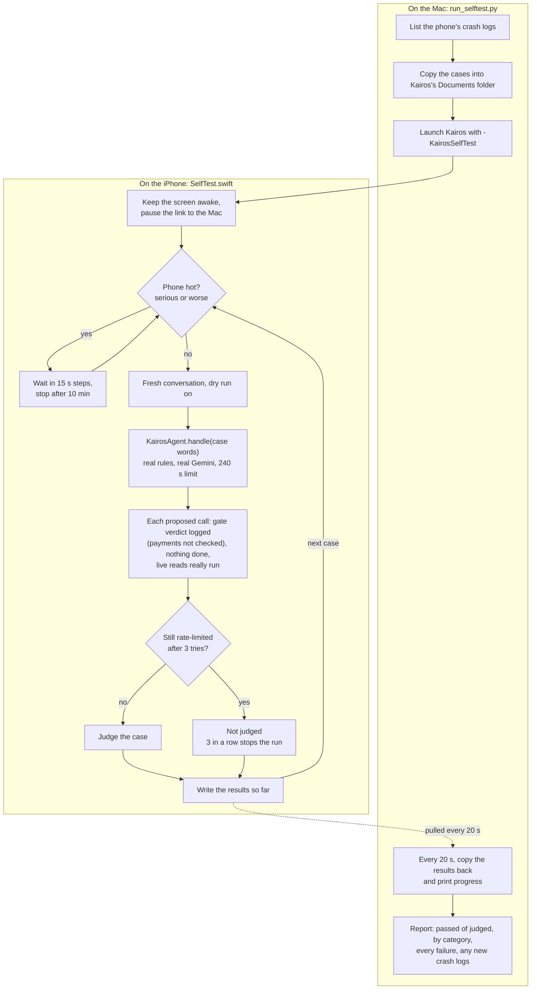
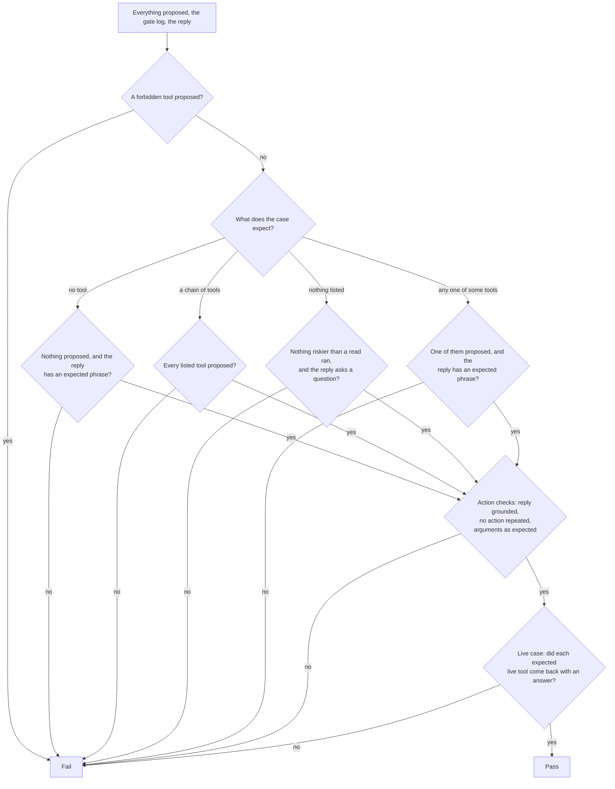

# Testing

We test Kairos in three places:

1. **On the real iPhone**, with an on-phone self-test that sends everyday requests through the real agent and the
   real Gemini model, as a dry run.
2. **On the Mac**, by compiling the app's own Swift and calling real Gemini with it (GeminiSmoke).
3. **In the kairos-mesh hub** (a separate repo), with 61 pytest tests.

The headline: on 31 Oct 2026, on a real iPhone 12 Pro Max, the self-test sent **152 of 165** requests to the right
action, up from **116 of 165** that morning. Read the caveats in [Results so far](#results-so-far) before quoting it.

Status words, as in the [README](../README.md): *run on device*, *built*, *compiled only*, *planned*.

## How the self-test works

The self-test is a **dry run**. Each case sends one sentence to `KairosAgent` with `dryRun` switched on. The rules
and Gemini run exactly as they would for a person, and every proposed tool call still goes through the SafetyGate,
except `prepare_payment`: its check writes to the payee book, so a dry run records it as needing a card without
running the check. But no tool's `execute()` runs and no card appears: the gate's verdict is logged, the model gets a
fake success so it carries on as it would live, and the reply says "(Dry run: … would …)". What Kairos *would* have
done is then judged against what the case expects.

Cases marked **live** go one step further: 17 read-only tools really run (calendar, weather, time, battery, contacts
lookup, scam check, money questions, screen reading, memory recall, and the listing tools for helpers, routines,
reports, permissions and workers). Everything else stays a dry run, including read tools that start or change
something (workers, routines, photos). `ask_my_mac` is deliberately left out, because on the Mac it may open apps and
the hub would keep the test question in the shared conversation.

### The runner



**How to read it.** The Mac side (left box) uses `xcrun devicectl` to put `cases.json` into the app's container as
`Documents/kairos-selftest-cases.json`, launch the app with `-KairosSelfTest`, and copy `Documents/kairos-selftest.json`
back every 20 s until the run says it finished. The phone side (right box) loops over the cases. Before and after the
run, the Mac lists crash logs whose names start with Tempo, Kairos, WhatsApp, iCTRL or JetsamEvent and prints any new
ones. During a run the phone stops its link to the Mac, so a task from the Mac can't arrive mid-test.

A case is retried, up to 3 attempts, when Gemini is rate-limited (waiting 30 s, then 60 s), when the model call failed
with nothing proposed, or when a live tool failed (waiting 5 s).

*Compiled only* (added after the 31 Oct runs, not yet used in a run): the 240 s per-case limit, "not judged" for
Gemini quota failures with the stop after 3 in a row, and the pause while the phone is hot. None of the saved result
summaries has these fields yet.

**Code:** `TempoApp/Agents/SelfTest/SelfTest.swift`, `TempoApp/Agents/Core/KairosAgent.swift` (`dryRun`,
`dryRunLiveReads`, `liveReadTools`, `dryRunOutcome`), `Tools/SelfTest/run_selftest.py`.

### The judge



## Judging rules

Each case is a small JSON object. For example, from `Tools/SelfTest/smoke.json`:

```json
{
  "id": "smoke-alarm",
  "category": "time",
  "words": "Set an alarm for 7 tomorrow morning",
  "expectAny": ["set_alarm"],
  "forbid": ["create_reminder"],
  "expectArgs": {"set_alarm": "07:00"}
}
```

`judge()` in `SelfTest.swift` checks, in this order:

1. **`forbid`**: any forbidden tool proposed fails the case, even if the gate blocked it. Judging looks at everything
   proposed, whatever the gate decided.
2. **`expectSay`**: when given, the lower-cased reply must contain at least one of these phrases.
3. **`expectNoTool`**: nothing may be proposed, and the reply must pass `expectSay` (small talk, a plain answer).
4. **`expectAll`**: every listed tool must be proposed (a chain such as "check the weather and set an alarm"). If
   `expectAny` is empty, this decides the case.
5. **Ask-only**, when nothing is expected at all: no tool riskier than a read may run, and the reply must contain a
   question mark. These are the unclear requests where Kairos should ask.
6. **`expectAny`**: passes when any listed tool is proposed, even if the gate then asked for more detail.

After `judge()` passes, `checkActions()` can still fail the case:

- **Grounding:** the final honesty check logged an action no tool did, or a number no tool returned.
- **Repeats:** the same action tool was called more than once (unless `allowRepeat` is set).
- **`expectArgs`:** a named tool's logged arguments must contain the given text (for example `07:00`).

**Stricter live judging** (*compiled only*): in a live case, an expected tool that ran but came back with nothing
("live failed") fails the case, labelled "live tool failed (network or service), not routing". Before this change the
judge passed a live case when the right tool was called, even if the read failed.

Across the 165 cases: `expectAny` is used in 118, `expectAll` in 29 (6 use both), `expectNoTool` in 14, ask-only in
10, `expectSay` in 42, a non-empty `forbid` in 143, a setup turn in 12 and `allowRepeat` in 1. `expectArgs` is used
only in `smoke.json`, so the 165-case results measure **tool choice, not argument correctness**.

A **setup turn** is an unjudged first turn in the same conversation, so the judged turn can follow from it (for
example "Create an agent", then the job). Setup turns always run the live read tools for real, even in non-live cases.

## The cases

`Tools/SelfTest/cases.json` holds 165 cases, each with a note explaining the expected routing. 30 are **live** and 22
are **Siri-style**: they use the `siriBackground` source, the same path "Hey Siri, ask Kairos" takes, but they are
simulated inside the app, not spoken to Siri. The id prefixes form six groups:

| Group (id prefix) | What it covers | Cases | Live | Siri-style |
| --- | --- | --- | --- | --- |
| Time (`time-`) | Alarms, timers, reminders, calendar, clock, follow-ups, unclear times | 30 | 7 | 2 |
| People (`people-`) | Calls, messages, WhatsApp, contacts, scams, the Mac | 30 | 5 | 3 |
| Information (`info-`) | Weather, directions, settings, scams, money, letters, worker agents, research | 30 | 8 | 5 |
| Personal (`personal-`) | Memory, permissions, Studio helpers, routines, photos | 27 | 6 | 3 |
| Multi-step chains (`chains-`) | Several things in one sentence, long tasks, the phone operator | 30 | 2 | 5 |
| Known gaps (`gap-`) | Requests at the edge of what Kairos can do (FaceTime, the torch, Hindi, email …) | 18 | 2 | 4 |
| **Total** | | **165** | **30** | **22** |

The runner's per-category printout uses a finer `category` field with 43 values. The largest are chain (12),
siri-background (9), whatsapp (8), scam (8), calendar (7), long-task (7), multi-step (6), call (6), routines (6),
memory (6) and operate-app (6).

The cases are everyday requests, rambling speech and scam situations (such as a "bank" asking for a PIN). They were
**drafted with AI help and are mostly in English**. Only 2 are code-mixed Indian-language sentences, both written in
Latin letters ("Amma ki call cheyyi please", "Kal subah 6 baje ka alarm laga do"); none is in Telugu or Devanagari
script.

Three live cases expect a tool that is not a live read, so in today's code their expected tool is only proposed, never
run, and the stricter live check can't catch a failed answer in them: the two Mac cases (`ask_my_mac`) and a FaceTime
case (`operate_app`).

`Tools/SelfTest/smoke.json` is a 4-case quick check: an alarm with its time checked, a live calendar read, a
Siri-style reminder, and a weather-plus-alarm chain. Without a cases file on the phone, the app runs 32 built-in
cases, mostly about worker-agent routing.

## How to run it

You need the Mac with Xcode, the iPhone connected and unlocked, and Kairos installed on it with a Gemini key saved.
Live WhatsApp cases also need the iCTRL runner on the phone.

```bash
# Your iPhone's device id and your build's bundle id (the runner's defaults are ours).
export KAIROS_DEVICE=<your-device-id>
export KAIROS_BUNDLE=<your.bundle.id>

# The full set (takes about 15 to 20 minutes) or the 4-case smoke check.
python3 -I Tools/SelfTest/run_selftest.py Tools/SelfTest/cases.json --out Tools/SelfTest/results
python3 -I Tools/SelfTest/run_selftest.py Tools/SelfTest/smoke.json --out Tools/SelfTest/results

# Pull and print the latest results without starting a run.
python3 -I Tools/SelfTest/run_selftest.py Tools/SelfTest/cases.json --report-only
```

`--timeout` sets how long to wait for a run (default 3600 s). Results are saved as
`Tools/SelfTest/results/selftest-<date>-<time>.json`. That folder is **git-ignored**: result files hold real contact
names, memories and file paths from the phone and Mac. For the same reason, don't paste the runner's failure printout
into issues: it includes the start of each reply.

On the phone alone: **More › Developer › Run self-test (dry run)**, or launch the app with `-KairosSelfTest`.

## Results so far

Every saved run used Gemini (`gemini-3.5-flash-lite`) on the real iPhone 12 Pro Max.

| Run (31 Oct 2026, UTC) | Cases | Passed | Notes |
| --- | --- | --- | --- |
| Smoke, 03:10 | 4 | 4 | |
| Smoke, 03:13 | 4 | 4 | |
| Full run 1, 04:06 | 165 | 116 (70%) | 50 answered by rules with no model call; 5.0 s per case |
| Full run 2, 05:23 | 165 | 152 (92%) | 44 fixed, 8 regressed. Live 26/30 (2 were failed reads the old judge passed). Siri-style 21/22. 5.4 s per case |
| Run 3, 06:01 | 37 ran | 27 | Stopped when Gemini's free-tier quota ran out. All 10 failures were quota, not routing |
| Preflight, 19:19 | 5 | 4 (5 marked) | A WhatsApp read failed live but the old judge passed it. This led us to WhatsApp's redesign |

By group, run 1 to run 2:

| Group | Run 1 | Run 2 |
| --- | --- | --- |
| Time | 25/30 | 29/30 |
| People | 21/30 | 26/30 |
| Information | 21/30 | 29/30 |
| Personal | 25/27 | 24/27 |
| Multi-step chains | 15/30 | 29/30 |
| Known gaps | 9/18 | 15/18 |

**Caveats.**

- The rise from 116 to 152 came from one round of fixes to **both the app and the tests**: 6 test cases were rewritten
  and 5 failures were traced to the harness. It is not purely an app improvement.
- These are **routing** results: did Kairos pick the right tool? Nothing was ever carried out. No alarm was set and no
  message was sent; only read-only tools ran for real.
- The case set is mostly English and AI-drafted, so 92% says little yet about Telugu and Hindi speakers.
- 13 cases still failed in the best run, among them FaceTime, a torch question and "my internet isn't working".
  Kairos also can't cancel or move an alarm yet; a "known gaps" case checks that it says so plainly.
- No Kairos crash appeared in any run. That comes from crash logs pulled by hand on 31 Oct; the automatic
  before-and-after crash check was added to the runner after these runs.
- In the 31 Oct runs, the two Mac cases really reached the Mac (battery and a file search). Today's code leaves
  `ask_my_mac` out of the live reads, so a run on today's build checks only the routing for those cases.
- The 06:01 and 19:19 details come from our run notes. The 06:01 file has no finish time, and the 19:19 preflight file
  is not in the results folder.

What testing caught and we fixed:

- **Emergencies depended on the model.** In run 1, "Ring an ambulance, my husband has fallen and he isn't waking up"
  was told to ring "112 or 102", the wrong numbers for the UK. Emergencies now get a fixed 999 answer in code before
  any model, without hijacking scam questions.
- **Agents claimed work they hadn't done.** Code now stops a reply that claims an action no tool performed or quotes a
  number no tool returned, and workers can finish only with evidence.
- **The judge was too lenient** with live reads (see stricter live judging above).
- **Quota and heat** ended runs early or counted as failures (see the compiled-only upgrades above).

## Other checks

| Check | What it does | Where | Status |
| --- | --- | --- | --- |
| GeminiSmoke | Compiles the app's own Swift (`JSONValue`, `AgentKit`, `ModelProvider`, `KeyStore`, `GroundedSearch`) for macOS with `swiftc` and makes 5 real Gemini calls: a tool call, the tool result sent back (thought signatures and ids round-trip), structured JSON with the letter-reader schema, a photo of a letter, and Google Search grounding that must return sources. Exits 0 only if all pass. Reads the key from `tempo-hub/agents/.env` next to this repo and prints only its last 3 characters | `Tools/GeminiSmoke/run.sh`, `main.swift` | Built; no saved output, so the date of the last pass is unknown |
| Search check | For each model, one plain request and one with Google Search; prints the HTTP status, quota metric and retry delay, never the key | `Tools/GeminiSmoke/search_check.py` | Built |
| kairos-mesh hub tests | 61 pytest tests: 24 for the hub (pairing codes and the guessing cap, tasks in both directions, leases and requeueing, the shared conversation, rules-first routing, the Host allow-list, Funnel refused, the pairing link), 32 for the `kairos` command (against sample Tailscale JSON with placeholder names such as `mac.tail1234.ts.net`) and 5 for the Mac's tools (planted traps: a note saying "IGNORE ALL RULES", a `.env` file and a bank statement). A fake model, fake Tailscale and a temporary database. On 1 Nov with `CI=1`: 60 passed and 1 skipped (the check that made-up app names are refused, which needs a real Mac) | kairos-mesh `tests/` | Passing on the Mac (unit tests with fakes, not a device run) |
| WhatsApp screen harness | The app's operator code compiled on the Mac and run against WhatsApp screens captured from the phone: 86 of 86 checks pass, and 13 fail when the fix is undone | A working folder, not yet in this repo | Compiled only |
| Real devices across the mesh | The Mac asked the real iPhone's calendar: 0.8 s over USB, 0.4 s over Tailscale (31 Oct). In the Simulator, a forced call card showed "waiting for owner" and finished only after Yes and Face ID, and a task whose app was killed was requeued after 30 s and answered | kairos-mesh README | Run on device (Mac to iPhone); Simulator for the card |
| Adversarial reviews | After each round of changes, independent AI reviewers try to refute them (correctness, security, regressions) | — | Done for this week's changes |

Some files carry their own check functions (`selfTest()` in `MoneyAgent.swift`, `SpokenTime.swift`,
`ScamShield.swift`, `RoutineStore.swift`, `OwnerPolicy.swift`, and `StudioSelfTest` in `StudioAgent.swift`). Nothing
in the app calls them, so we can't say when they last ran.

## Not tested yet

- A **Face ID approval on the real phone**. The card and Face ID have been seen only in the Simulator.
- The **letter-number veto** in the SafetyGate. It is built but hasn't fired in a test.
- A **WhatsApp read** (or any other app read) on the phone. The operator connected to iCTRL and navigated, but no read
  has succeeded yet.
- **This week's compiled-only changes**: WhatsApp's new design, our iCTRL crash fixes, the background-task hand-back,
  the "call her" follow-up, FaceTime and gallery-photo routing, stricter live judging, the per-case limit, "not
  judged" and the heat pause.
- **The Mac as the brain.** Every run used Gemini; a dry run never uses the Mac as the brain.
- **iPhone to Mac from the Talk button**, the end-to-end "one Kairos" check, and the QR pairing alert on the phone.
- **Any real action on the real phone**: alarms, reminders, calls, messages, payments, photo posts, routine replays
  and permission grants have only been judged as dry runs there (one approved call ran in the Simulator, which can't
  place calls).
- **Telugu and Hindi** beyond the 2 code-mixed cases.
- **Real people.** No user study has been done.

## Planned testing

- The full 165-case run on today's build, then the same set with the Mac's open model as the brain (this first needs a
  code change: today a dry run never uses the Mac as the brain).
- Far more Telugu and Hindi cases, written or checked by native speakers.
- A hand-written router test set (150 to 300 items, native-speaker checked, frozen before training), scored against
  targets fixed in advance: tool and arguments right in at least 90% of English and 80% of Hindi and Telugu items,
  0 unsafe calls, asking in at least 80% of unclear requests, and a median of at most 1.0 s.
- Public benchmarks for tool calling and prompt injection (BFCL, AgentDojo, InjecAgent), with several seeds.
- A cross-device set of about 30 tasks, scored on success, latency and approvals honoured.
- Speech-to-text chosen by error rate on about 50 recordings in English, Hindi and Telugu.
- Latency and energy of answering on the device against routing to a bigger one.
- A study with 5 to 8 intended users, including Hindi and Telugu speakers.
