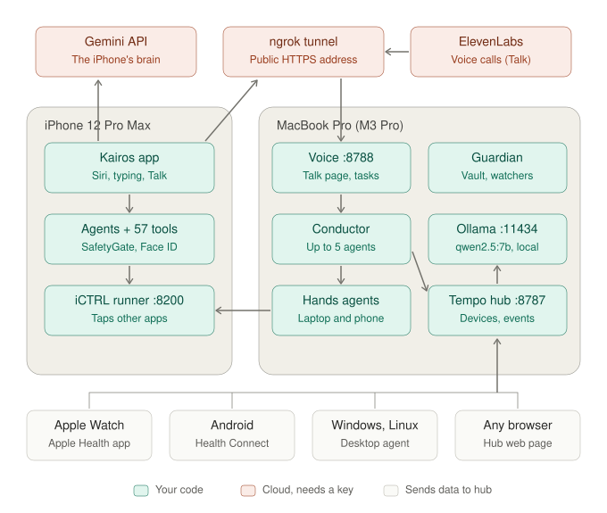

# 01 — The whole system, as it runs today

## Why we drew this
Before building anything new, we needed one honest map of what already exists across the iPhone, the Mac and the
cloud: every process, port and connection. Without it, it's easy to rebuild something that already works, or to
claim something that doesn't.

## The use case it serves
**"Where does each part of Kairos actually live?"** For example: when you ask Kairos something on the phone, which
company's computer hears it? Which parts still need an API key? What breaks if the Mac is asleep?

## How to read it
- **Teal** is our code. **Coral** is a cloud service that needs an API key. **White** boxes are other devices that only send data.
- **iPhone:** the Kairos app takes requests (Siri, typing, Talk). Its agents pick one of 57 tools, the safety gate checks the choice, and the iCTRL runner can operate other apps. The app's brain is **Gemini**, called with the owner's key.
- **Mac:** everything arrives through one public **ngrok** address:
  - `/voice/*` goes to the voice server (`:8788`), which hands jobs to the **conductor**. The conductor runs up to 5 agents: the laptop agent, and the phone agent that drives the iPhone through iCTRL.
  - `/api/ask` goes to the **Tempo hub** (`:8787`), which answers with **Ollama** (`:11434`).
  - The **Guardian** watches the hub's events.
- **Other devices** (Apple Watch via Apple Health, Android via Health Connect, Windows/Linux via the desktop agent, any browser) push their data into the hub.

## Real today vs. not
- **Real:** every box on this diagram.
- **Not real:** the Mac asking the iPhone's own agent for anything. The only Mac → iPhone path is iCTRL tapping the screen.
- **Only Ollama starts by itself** (a LaunchAgent). The hub, the voice server, the agents service, Guardian, ngrok and the iCTRL runner are started by hand.

## Related
- Code: `tempo-ios` (kairos-ios), `tempo-hub` (not in git), `oxford-model-only`, `phone-control/`
- Next: [05 — two-way Jarvis](05-two-way-jarvis.md) shows what we add on top of this.
