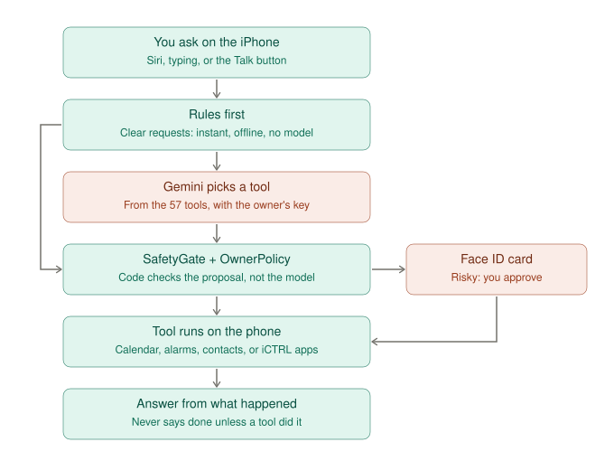

# 02 — One request on the iPhone

## Why we drew this
This is the part of Kairos that's already proven, and the reason it's different from a chatbot: **the model only
proposes; code decides.** Every cross-device feature we add has to keep this path intact. A task that comes from
the Mac must go through the same safety gate and the same Face ID card as one spoken on the phone.

## The use case it serves
Someone who isn't confident with phones says *"remind me to take my tablets at 8"*, or *"ring the number on this
letter"*. The first should just happen. The second must **not** happen if the number came from a scam letter, and a
real call should still need the owner's Face ID.

## How to read it
1. **You ask:** Siri, typing, or the Talk button.
2. **Rules first:** clear requests ("set a timer for 10 minutes") are matched by code with no model, so they work offline. They skip straight to the safety check (the line on the left).
3. **Gemini picks a tool:** for anything else, the model proposes one of the 57 tools with its arguments.
4. **SafetyGate + OwnerPolicy:** deterministic code checks the proposal.
   - A number or link that came from a letter or web page is refused.
   - Banks, passwords and PINs are always blocked.
   - Calls, messages and payments need a card.
5. **Face ID card:** for risky actions, the owner approves on the phone.
6. **The tool runs on the phone:** calendar, alarms, contacts, or another app through iCTRL.
7. **The answer comes from what actually happened.** Kairos never says "done" unless a tool did it.

## Real today vs. not
- **Real:** all of it, in kairos-ios (`KairosAgent.swift`, `SafetyGate.swift`, `OwnerPolicy.swift`, `AgentConfirmCard.swift`).
- **To change:** step 3 still uses Gemini. The plan replaces it with an open model ([07](07-open-model-stack.md)) and later a fine-tuned router ([08](08-router-training.md)).

## Related
- The baseline eval in `kairos-models` scores open models on this exact decision (step 3) with the app's own 57 tools.
