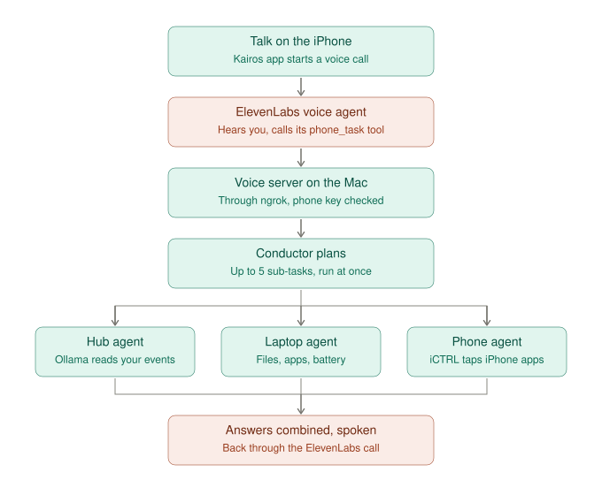

# 03 — The cross-device path that exists today

## Why we drew this
To be precise about what "cross-device" means in the current code, and what it doesn't. It's the closest thing to
Jarvis we already have, and it shows exactly which piece is missing.

## The use case it serves
On a voice call from the iPhone: *"check the weather, my laptop battery, and whether my train was late."* One
request, three jobs, done at the same time on different machines, then spoken back as one answer.

## How to read it
1. **Talk** on the iPhone starts an ElevenLabs voice call.
2. The voice agent calls its `phone_task` tool. The request goes through the ngrok tunnel to the **voice server** on the Mac, after a phone-key check.
3. The **conductor** splits the request into up to 5 sub-tasks and runs them at once:
   - **Hub agent:** asks the hub; Ollama answers from your synced events.
   - **Laptop agent:** works on the Mac (files, apps, battery) with a short list of safe actions.
   - **Phone agent:** drives the iPhone's screen through iCTRL. Gemini, or Ollama for private apps, decides each tap.
4. The answers are combined and spoken back on the call.

## What this shows is missing
- **The Mac never asks the iPhone's own agent.** Phone jobs are done by tapping the screen through iCTRL, so they skip the phone's 57 tools and its Face ID gate.
- **It's one-way.** The phone asks and the Mac works; the Mac can't start work on the phone's agent.
- **Agents can't move between devices** mid-task.
- **The phone agent needs the iPhone unlocked with the iCTRL runner alive,** and it takes one job at a time.

## Related
- Code: `tempo-hub/hands/conductor.py`, `hands/laptop_agent.py`, `phone/phone_agent.py`, `voice/token_server.py`
- What fixes it: [05 — two-way Jarvis](05-two-way-jarvis.md)
