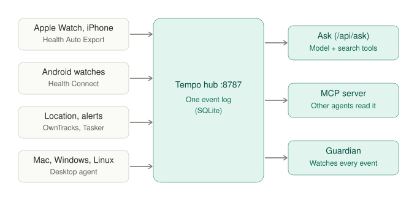

# 04 — How data from every device reaches the hub

## Why we drew this
The hub already collects data from devices of **any brand**. That matters for Jarvis: when a device is off or
away, another device can still answer from the hub's copy instead of failing.

## The use case it serves
*"Did anything happen with my train today?"*, *"How did I sleep?"*, *"Which of my devices are syncing?"* These are
answered on the Mac from data that came from a watch, a phone's notifications, or another laptop, with that device
nowhere near you.

## How to read it
- **Left:** each kind of device pushes events through an app it already has. Apple Health via Health Auto Export, Android via Health Connect, location via OwnTracks, notifications via Tasker, computers via the desktop agent.
- **Middle:** the **Tempo hub** keeps **one event log** in SQLite. Health, location and notifications are "vault" data: only a model on the Mac (or your local network) may read them.
- **Right:** three things read the log:
  - **`/api/ask`:** a model answers with search tools.
  - **The MCP server:** other agents can read it.
  - **The Guardian:** watches every event for scams and attacks.

## Real today vs. not
- **Real:** all of it, in `tempo-hub`.
- **Missing:** data only flows **into** the hub. Nothing flows back out to the devices' agents. And the hub's copy doesn't yet include calendar, notes or a file index, which phase 4 of the plan adds for "works when the phone is away".

## Related
- Code: `tempo-hub/hub/main.py` (ingest, ask), `hub/db.py`, `hub/mcp_server.py`, `guardian/`, `agent/desktop_agent.py`
