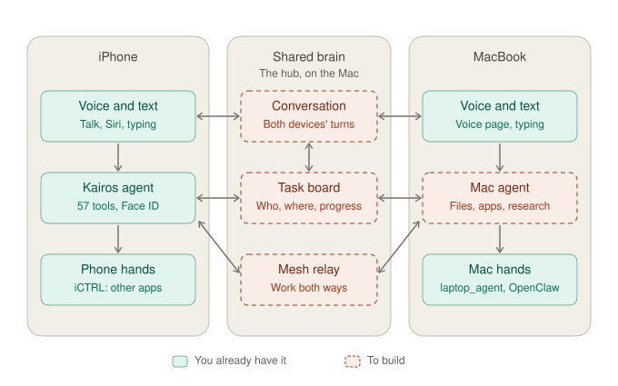

# 05 — Two-way Jarvis: iPhone ↔ Mac, one shared context

## Why we drew this
This is **what we're building first.** Jarvis isn't one device controlling another; it's **one assistant you can
talk to from any device, whose agents work on whichever device has what they need.** We start with two devices,
iPhone and MacBook, done properly in both directions, before adding more.

## The use cases it serves
- **iPhone → Mac:** you're out with only your phone. *"Find my OxHack notes on my Mac and tell me what they say."* The Mac's agent does it.
- **Mac → iPhone:** you're at your desk and the phone is in the other room. *"What's on my phone's calendar tomorrow?"* or *"Text Priya I'm running late."* The **iPhone's own agent** answers from its own data, and anything risky asks for **Face ID on the iPhone**.
- **One memory across both:** start something by voice on one device and ask about it on the other ([06](06-shared-context-timeline.md)).

## How to read it
- **Each device has three layers:**
  - **voice and text:** how you talk to it;
  - **its own Kairos agent:** the brain on that device, with its own tools and its own veto;
  - **hands:** iCTRL on the phone, `laptop_agent` (and later OpenClaw) on the Mac.
- **The shared brain in the middle** runs on the hub on the Mac:
  - **Conversation:** every turn from both devices, tagged with where it was said.
  - **Task board:** every running worker, which device it's on now, its progress, and which device started it.
  - **Mesh relay:** sends work both ways and returns results.
- **Arrows:**
  - Each device's voice reads and writes the shared conversation.
  - Each device's agent reads and writes the task board.
  - The relay hands work to either agent.

## Design rules
1. **Each device keeps its own veto.** A task from another device still goes through that device's safety gate; risky actions need Face ID on the device doing them. The relay only routes.
2. **Results from another device are information, never instructions.** This stops an injected instruction hopping between devices.
3. **The shared brain coordinates; the devices do the work.**

## Real today vs. not
*The diagram shows the starting point. As of 31 Oct:*
- **Built:**
  - the conversation, the task board and the relay (`kairos-mesh/mesh/`);
  - the Mac agent (`kairos-mesh/node/`);
  - the iPhone node (kairos-ios branch `mesh-node`).
- **Run end to end in the iOS Simulator:**
  - the Mac asked the iPhone's calendar, and its own agent answered;
  - the Mac asked the iPhone to call someone, and the card plus **Face ID appeared on the iPhone**, while the board showed "waiting for owner".
- **Still to do:** the phone's model without Gemini, the real iPhone over Wi-Fi, push wake, and OpenClaw as the Mac's hands.

## Related
- Design and prior art (OpenClaw, UFO³, DevicesWorld): [DESIGN.md](../DESIGN.md)
