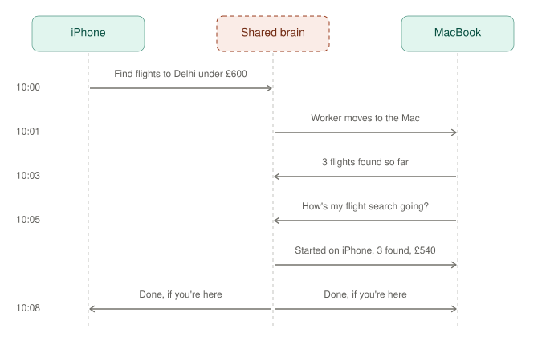

# 06 — One memory across devices: a worked example

## Why we drew this
To answer: *"If I give my iPhone a task and five minutes later ask my MacBook about it, will the Mac know?"* With
this design it will, and that's what makes Kairos feel like **one** assistant rather than two separate ones.

## The use case it serves
You're walking, and you tell your iPhone *"find flights to Delhi under £600"*. You sit down at your Mac and ask
*"how's my flight search going?"*. The Mac answers with what the iPhone started, where the work is now, and what it
has found so far.

## How to read it
Three lanes: the iPhone, the shared brain (the hub) and the MacBook. Time runs downwards.

| Time | What happens |
|---|---|
| 10:00 | You ask on the iPhone. The shared brain records your turn and starts a worker |
| 10:01 | The worker **moves to the Mac** to search, because the Mac has the browser and the bigger model |
| 10:03 | It reports progress ("3 found so far") to the task board |
| 10:05 | You ask the Mac. Its context is **rebuilt from the shared conversation and task board**, so it knows the task started on the iPhone, where it is, and the best price so far |
| 10:08 | The task finishes, and the result goes to **whichever device you're using** |

## The key idea
An AI's context window always belongs to a single request, so two devices can't literally share one. **Every time
you speak, on either device, that device's window is rebuilt from the same shared state.** This lifts two things
the iPhone app already does for one device up to the hub:
- `PhoneContext`: "what is happening right now", sent with every request.
- `VoiceContextBridge`: live updates into a voice call.

## Real today vs. not
- **Real, on one device only:** `PhoneContext` and `VoiceContextBridge` in kairos-ios.
- **To build:** the shared conversation, the task board, live updates to whichever device you're talking to, and workers that move between devices.

## Related
[05 — two-way Jarvis](05-two-way-jarvis.md) · phase 1 in [PLAN.md](../PLAN.md)
