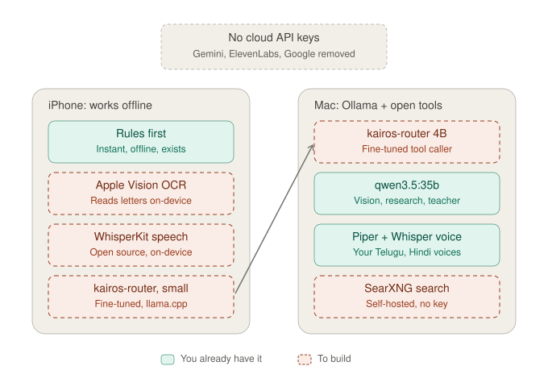

# 07 — Open models, no API keys

## Why we drew this
Kairos should run on hardware you own, with open models and **no paid API keys**. That's better for privacy, there
are no bills, and the basics still work offline. It also forces a real **edge AI** design: what runs on the phone,
and what gets handed to the Mac.

## The use case it serves
- **Offline:** someone with a cheap phone and patchy signal still gets *"set my medicine alarm"* done on the phone.
- **Private:** *"read this letter for me"* is read on the phone; the letter never goes to a cloud.
- **Hard requests** go to the bigger model on the Mac.

## How to read it
- **iPhone (works offline):**
  - **rules first** (already built);
  - **Apple Vision OCR** reads letters on the device;
  - **WhisperKit** turns speech into text on the device;
  - a **small fine-tuned router** picks the tool.
- **Mac (Ollama + open tools):**
  - the **4B fine-tuned router** for tool calling and planning;
  - **qwen3.5:35b** for vision, research write-ups, and teaching the router;
  - **your Piper voices** plus Whisper for speech;
  - **SearXNG** for web search without a key.
- **The arrow:** when the phone's router is unsure, or the job needs planning, research or vision, it hands the request to the Mac.

## Choices we checked (30 Oct 2026)
- **Speech to text:**
  - **WhisperKit** (MIT) on Apple devices.
  - **sherpa-onnx** (Apache-2.0) elsewhere.
  - **IndicConformer** (MIT) for Telugu and Hindi.
  - Pick by testing on your own recordings.
- **Text to speech:** your **Piper voices**, run with **sherpa-onnx**. The new Piper runtime (`piper1-gpl`) is **GPL-3.0**; the original MIT repo is archived.

## Real today vs. not
- **Real:** rules first; Ollama with qwen2.5:7b, qwen3.5:4b and qwen3.5:35b on the Mac; your Piper voices (in another repo).
- **To build:** everything dashed. Plan details: kairos-models (a separate project, not in this repo) and [PLAN.md](../PLAN.md).
