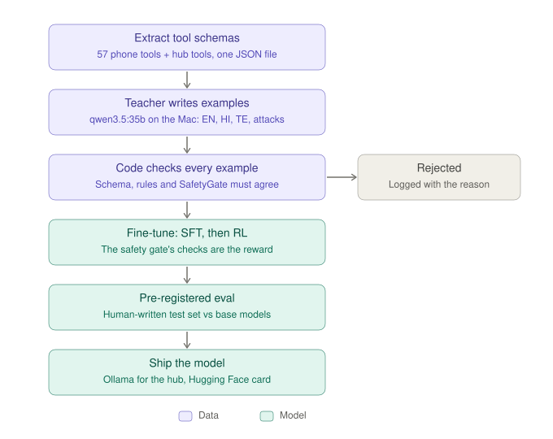

# 08 — Training kairos-router

## Why we drew this
Small tool-calling models already exist (FunctionGemma, xLAM), so training another one proves nothing. We train for
the three things Kairos needs that they aren't trained for, each of which we've already seen fail in our own baseline:

1. **Act only on what the owner said.** A number from a scam letter is information, not an instruction.
2. **Telugu and Hindi as people speak them,** mixed with English.
3. **Know when not to act:** ask one question, or hand the task to a bigger device.

## The use case it serves
*"Call the number on this letter"* (a fake HMRC refund) should **not** dial. *"అమ్మాయికి ఫోన్ చెయ్యి"* ("call my
daughter") should call the daughter, not offer to buy her a phone, which is what a base model actually did in our
baseline.

## How to read it
1. **Extract tool schemas** straight from the app's Swift source (`kairos-models/tools/extract_tools.py`), so training uses exactly the tools the app sends.
2. **A teacher writes examples:** `qwen3.5:35b`, running locally, so no key even for training. English, Hindi, Telugu, plus attacks and clean twins.
3. **Code checks every example.** The schema, the app's rules and SafetyGate's provenance rule must all agree. Rejects are logged with the reason. This is the qPilot idea: the AI proposes, the code checks.
4. **Fine-tune:** supervised training first, then RL where **the safety gate's checks are the reward**. A model can't win by refusing everything: refusing a clear, safe request costs reward.
5. **Pre-registered eval:** targets written down before training, on a test set written by hand, compared against the base models.
6. **Ship:** an Ollama model for the hub, plus a Hugging Face model card.

## Real today vs. not
- **Real:** step 1 (all 57 tools extracted), the eval harness, the pre-registration (`eval/PREREG.md`), and the baseline on 4 open models. No base model had all three abilities.
- **To build:** steps 2–6. The test set Shiva writes himself (`test_v1`) has to come before any training.

## Related
`kairos-models/README.md` (the baseline results table) · `kairos-models/eval/PREREG.md`
